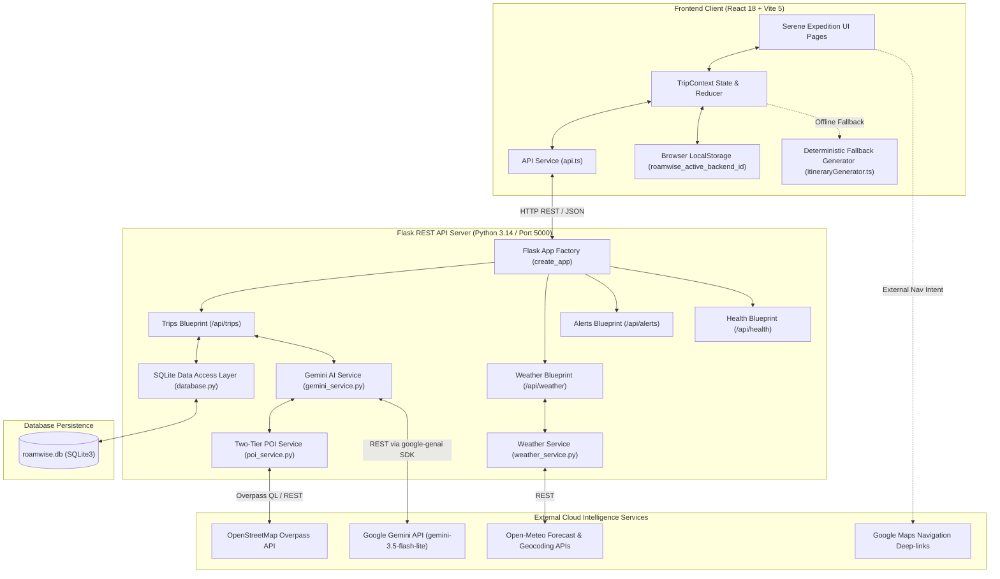
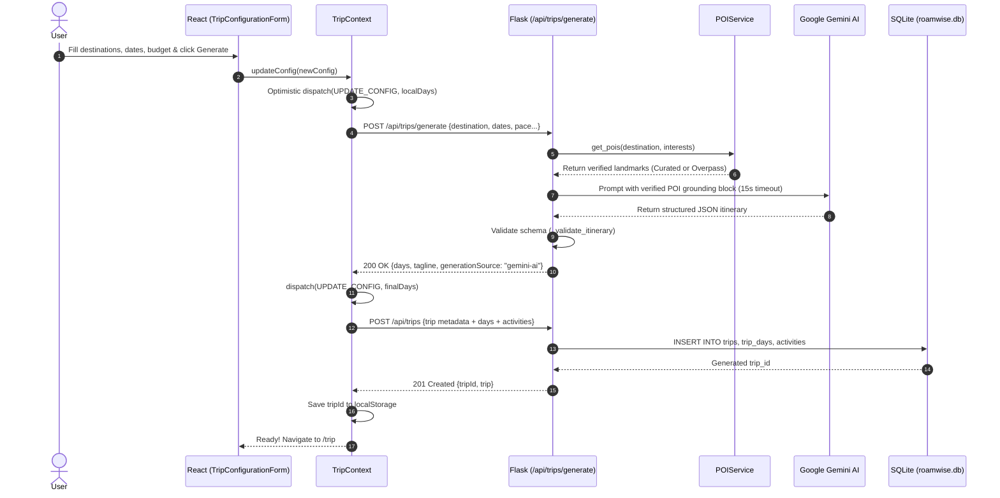
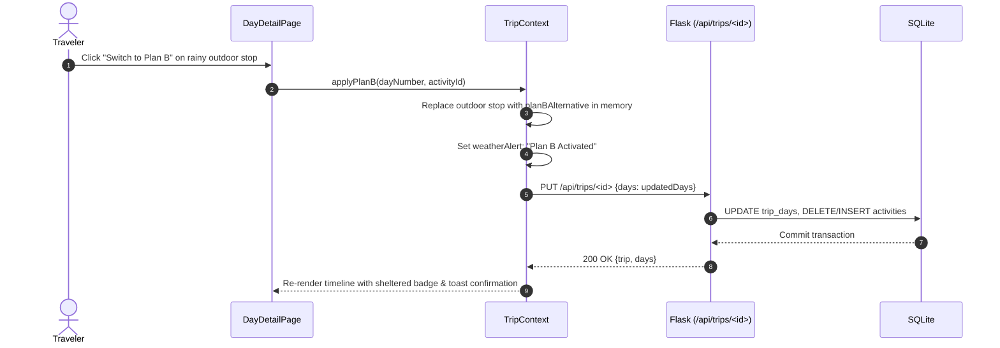
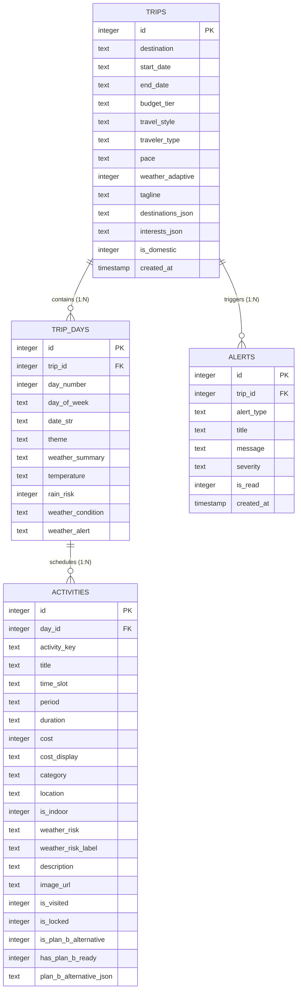
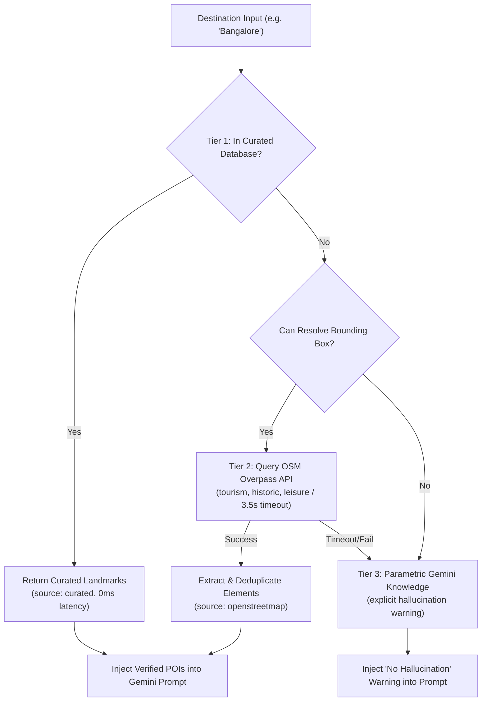

# ROAMWISE — COMPREHENSIVE FORENSIC APPLICATION AUDIT & TECHNICAL DOSSIER

**Date of Audit**: October 31, 2026  
**Auditor**: Principal Software Architect & QA Engineering Directorate  
**Project**: RoamWise — AI-Powered Adaptive Travel Planner  
**Active Git Branch**: `feature/serene-expedition-ui`  
**Application State**: Full-Stack Functional Prototype with Live Flask Backend, Gemini 2.5/3.5 Integration, Two-Tier POI Discovery Layer, Open-Meteo Weather Pipeline, SQLite Persistence, and Serene Expedition UI.

---

## 1. PROJECT CONTEXT & PRODUCT VISION

### 1.1 Product Vision & Core Proposition
RoamWise is conceived as a context-aware, hyper-personalized, and dynamic travel intelligence companion. Unlike conventional travel planners that generate static itineraries (rigid lists of tourist spots printed or exported once), RoamWise operates on the foundational principle of **continuous adaptive planning**.

Travel in the real world is subject to unpredictability: sudden afternoon rain squalls, unexpected flight or cab delays, transit strikes, overcrowded monuments, early museum closures, and physical fatigue. Traditional travel planners leave users stranded when unforeseen disruptions occur. RoamWise solves this by treating an itinerary not as a rigid timetable, but as an **elastic execution graph** that monitors real-time environmental signals (such as live weather radars and transit pacing) and provides instantaneous, safe adaptations (e.g. Plan B sheltered indoor alternatives, schedule re-pacing, and natural-language rerouting) without erasing completed activities or dropping locked reservations.

### 1.2 Problem Being Solved
1. **The Fragility of Static Itineraries**: Conventional planners (e.g., standard LLM wrappers or static travel blogs) generate a multi-day plan once. The moment an unexpected 2-hour rainstorm hits or a road is blocked, the entire daily schedule collapses.
2. **Attraction Hallucination & Fabricated Venues**: Unconstrained LLM travel assistants frequently invent fictional museums, generic walking tours, and non-existent waterfronts (e.g., "Bangalore Heritage Quarter Walking Tour" or "Bangalore Grand Botanical Sanctuary") instead of grounding plans in real, geographically verified landmarks.
3. **Disconnection Between Weather Signals and Action**: Standard weather apps display rain percentages without connecting them to tourist activities. A traveler sees "70% rain at 2:00 PM" but has no automated way to swap their outdoor hike to a nearby indoor art gallery.
4. **Data Loss During In-Trip Adaptation**: When users attempt to adjust plans mid-trip using generic chat interfaces, the AI frequently reschedules stops the user has already visited that morning or drops critical booked reservations.

### 1.3 Target Users & Personas
- **Curious Solo Explorers**: Value authentic local cultural immersion, independent pacing, artisan workshops, and flexible timing (e.g., Persona "Aarav Sharma", Solo traveler in Bangalore/Jaipur).
- **Couples & Leisure Travelers**: Seek balanced, scenic schedules with high visual appeal, golden hour vista alignment, and comfortable transitions.
- **Fast-Paced Friend Groups**: Prioritize packed multi-stop circuits, high-energy adventure landmarks, and cost-effective budget tracking.
- **Families with Children / Seniors**: Demand relaxed pacing, reliable sheltered backups, low physical strain, and predictable logistics.

### 1.4 Major Product Modules
1. **Discovery & Inspiration Hub (`HomePage.tsx` / Screen 08)**: Curated Indian circuits, regional exploration cards, trending destinations, and quick itinerary jump-points.
2. **Multi-Stop Trip Configuration Engine (`TripConfigurationForm.tsx` / Screen 15-16)**: Multi-destination route inputs, domestic vs. international toggle, dynamic date picking, budget tiers, travel pace selector, and interest category chips.
3. **AI Generation & Pipeline Visualizer (`GeneratingPage.tsx` / Screen 10)**: Real-time generation progress feedback, milestone transitions, and engine travel tips.
4. **Itinerary Overview Dashboard (`ItineraryOverviewPage.tsx` / Screen 13)**: Multi-day roadmap, daily summaries, cost estimates, calendar export simulation, and active expedition controls.
5. **Day Timeline & Activity Execution (`DayDetailPage.tsx` / Screen 07 & 02)**: Morning, afternoon, and evening activity cards, completion check-offs, weather risk badges, and direct Plan B activation triggers.
6. **Weather Intelligence & Radar Sentinel (`WeatherPage.tsx` / Screen 19)**: Open-Meteo live atmospheric observations, hourly precipitation curves, multi-day forecasts, and microclimate alerts.
7. **Interactive Route & Waypoint Canvas (`MapPage.tsx` + `MapView.tsx` / Screen 07)**: Waypoint visualization, distance/duration heuristics, and external navigation links.
8. **Adaptive Plan B System (`PlanBBottomSheet.tsx` / Screen 12)**: One-click substitution of weather-compromised outdoor activities with verified indoor shelters.
9. **Natural-Language Replanning Engine (`ReplanningPage.tsx` & `ReviewPlanPage.tsx` / Screen 18 & 09)**: Conversational disruption input ("cab delayed 45m"), AI re-sequencing, and original vs. revised diff comparison.
10. **My Trips Expedition Logbook (`MyTripsPage.tsx` / Screen 01)**: Ongoing, upcoming, and completed trip archiving with SQLite persistence.
11. **User Profile & Preference Management (`ProfilePage.tsx` / Screen 06 & 03)**: Traveler identity, currency, theme toggles, and expedition history.

---


## 2. COMPLETE PROJECT ARCHITECTURE

### 2.1 System Architecture Overview
RoamWise is implemented as a decoupled, full-stack client-server web application with external AI and data intelligence services.



### 2.2 Frontend Architecture
- **Framework**: React 18.3.1 with TypeScript 5.6.2.
- **Build Tool**: Vite 5.4.11 with `@vitejs/plugin-react` 4.3.3.
- **Routing**: React Router 7.18.5 (`BrowserRouter`, `Routes`, `Route`, `Navigate`).
- **Styling**: Tailwind CSS 3.4.15 with custom theme tokens (`Serene Expedition` design system), PostCSS 8.4.49, Autoprefixer 10.4.20.
- **Icons**: Google Material Symbols Outlined (loaded via Google Fonts CDN in `index.html`) + Lucide React 1.16.0.
- **State Management**: React Context API (`TripContext`) paired with `useReducer` and `useRef` for synchronization state and optimistic UI updates.
- **API Client**: Standard ES6 `fetch` wrapper in `frontend/src/services/api.ts` with base URL proxy (`/api` routed to `http://127.0.0.1:5000` via Vite development server).
- **Offline / Local Fallback**: Deterministic procedural generator in `frontend/src/mock/itineraryGenerator.ts` providing instant fallback when backend is offline.

### 2.3 Backend Architecture
- **Framework**: Python 3.14 with Flask 3.0+ and Flask-CORS 4.0+.
- **Application Structure**: Application Factory pattern in `backend/app/__init__.py` registering blueprints: `trips_bp`, `weather_bp`, `alerts_bp`, `health_bp`.
- **Database Driver**: Python standard library `sqlite3` with row factory `sqlite3.Row` and foreign key pragma enforcement in `backend/app/database.py`.
- **AI Integration**: Official `google-genai` SDK (version 2.0.0+) utilizing model `gemini-3.5-flash-lite` (configurable via `GEMINI_MODEL` environment variable).
- **POI Intelligence**: Custom two-tier service (`backend/app/services/poi_service.py`) combining curated landmark registries with OpenStreetMap Overpass queries.
- **Weather Service**: `backend/app/services/weather_service.py` interfacing with Open-Meteo REST API and geocoding endpoint, with fallback microclimate simulation.

### 2.4 End-to-End Sequence Diagrams

#### Sequence 1: Trip Generation, Grounding & Persistence


#### Sequence 2: Adaptive Plan B Substitution & SQLite Sync


---


## 3. COMPLETE FRONTEND SCREEN-BY-SCREEN AUDIT

RoamWise features 12 primary client-rendered pages registered in `frontend/src/App.tsx`. Below is the complete forensic audit of every screen.

### 3.1 Screen Inventory Table

| # | Screen Name | Route URL | File Path | Main Component | Corresp. Stitch Screen | Implementation Status |
|---|-------------|-----------|-----------|----------------|------------------------|-----------------------|
| 1 | Home Dashboard & Discovery | `/` | `frontend/src/pages/HomePage.tsx` | `HomePage` | Screen 08 / Screen 20 | IMPLEMENTED (Dual Mode) |
| 2 | My Trips & Expedition Logbook | `/trips` | `frontend/src/pages/MyTripsPage.tsx` | `MyTripsPage` | Screen 01 | IMPLEMENTED |
| 3 | Trip Configuration Engine | `/plan` | `frontend/src/pages/PlanTripPage.tsx` | `TripConfigurationForm` | Screen 15 / Screen 16 | IMPLEMENTED |
| 4 | AI Generating Pipeline | `/generating` | `frontend/src/pages/GeneratingPage.tsx` | `GeneratingPage` | Screen 10 | PARTIALLY SIMULATED |
| 5 | Itinerary Overview Dashboard | `/trip` | `frontend/src/pages/ItineraryOverviewPage.tsx` | `ItineraryOverviewPage` | Screen 13 | IMPLEMENTED |
| 6 | Day Detail Timeline | `/trip/day/:dayId` | `frontend/src/pages/DayDetailPage.tsx` | `DayDetailPage` | Screen 07 / Screen 02 | IMPLEMENTED |
| 7 | Weather Intelligence & Radar | `/weather` | `frontend/src/pages/WeatherPage.tsx` | `WeatherPage` | Screen 19 / Screen 14 | IMPLEMENTED |
| 8 | Navigation & Live Route Map | `/map` | `frontend/src/pages/MapPage.tsx` | `MapView` | Screen 07 | PARTIALLY SIMULATED |
| 9 | Something Came Up? Replanning | `/replan` | `frontend/src/pages/ReplanningPage.tsx` | `ReplanningPage` | Screen 18 | IMPLEMENTED |
| 10 | Updated Plan Review & Diff | `/review-plan` | `frontend/src/pages/ReviewPlanPage.tsx` | `ReviewPlanPage` | Screen 09 | IMPLEMENTED |
| 11 | Sentinel Alerts & Notifications | `/alerts` | `frontend/src/pages/AlertsPage.tsx` | `AlertsPage` | Screen 14 / Screen 10 | PARTIALLY SIMULATED |
| 12 | User Profile & Preferences | `/profile` | `frontend/src/pages/ProfilePage.tsx` | `ProfilePage` | Screen 06 / Screen 03 | IMPLEMENTED |

---

### 3.2 Forensic Audit by Screen

#### Screen 1: Home Dashboard & Discovery Hub
- **Route URL**: `/`
- **Source File**: `frontend/src/pages/HomePage.tsx` (approx. 629 lines)
- **Main Purpose**: Serves as the primary entry point. Operates in two distinct states: **Discovery Hub** (when no trip is active or user clicks toggle) and **Active Expedition Dashboard** (when a user has an active saved trip).
- **Intended User**: All users (new visitors, returning travelers checking current trip progress).
- **Visible Sections**:
  - View Mode switcher pill (`Switch to Discovery View` / `Switch to Active Trip View`).
  - Active Expedition Hero Card with progress ring, dates, live weather snippet, and quick action buttons.
  - Active Weather Warning alert card with quick Plan B review button.
  - Today's Activity schedule list (chronological morning/afternoon/evening stops).
  - Quick Expedition Links matrix (`Timeline`, `Live Weather`, `Route Map`, `Replanning`).
  - Discovery Hub: Search input, curated Indian circuits carousel (`CURATED_CIRCUITS`), popular regional destinations, interest categories chips, and recently viewed circuits.
- **UI Components**: `Header`, `BottomNav`, Material Symbols icons, progress bars, circuit cards.
- **Buttons and Controls**: View mode switcher pill, "Plan New Trip" primary CTA, "Resume Journey", "Switch to Plan B", "Modify Itinerary", category chips.
- **Input Fields**: Destination search input in Discovery mode.
- **User Interactions**: Toggle between active trip and discovery view, click circuit card to prepopulate configuration, click activity to view details.
- **Navigation Destinations**: `/plan`, `/trip`, `/trip/day/1`, `/weather`, `/map`, `/replan`.
- **State Dependencies**: `useTrip()`: `state.config`, `state.days`, `hasActiveTrip`, `isDemoMode`, `savedTrips`.
- **API Dependencies**: Reads hydrated trips from `TripContext`.
- **Database Dependencies**: Hydrated from `trips`, `trip_days`, `activities` via `GET /api/trips`.
- **Data Source**: SQLite via `TripContext` or static `CURATED_CIRCUITS` in `sampleTrip.ts`.
- **Loading States**: Shows discovery dashboard during hydration.
- **Empty States**: If database has 0 trips, gracefully renders Discovery Hub without showing fictional active trips.
- **Error States**: Falls back to Discovery View if API is unreachable.
- **Responsiveness**: Mobile-first flex layout, container max-w-4xl for tablet/desktop.
- **Actual Implemented Functionality**: Dynamic progress calculation, real weather alert detection, trip selection, discovery browsing.
- **Placeholder / Simulated**: Curated circuits in discovery view are static references (`sampleTrip.ts`), recently viewed list is static.
- **Known Defects**: None critical.

#### Screen 2: My Trips & Expedition Logbook
- **Route URL**: `/trips`
- **Source File**: `frontend/src/pages/MyTripsPage.tsx` (approx. 434 lines)
- **Main Purpose**: Central expedition logbook where users browse saved trips, track progress, inspect past trips, or delete trips.
- **Intended User**: Returning travelers managing multiple itineraries.
- **Visible Sections**:
  - Page header with "Plan New Trip" CTA.
  - Filter pills: `All Trips (N)`, `Ongoing (N)`, `Upcoming (N)`, `Completed (N)`.
  - Ongoing Expedition Featured Card with progress bar, dates, and quick action matrix.
  - Upcoming Expeditions grid with destination images, duration tags, and delete/open actions.
  - Past Completed Memories grid.
  - Demo Mode warning banner with "Exit Demo" action when sample data is shown.
- **Buttons and Controls**: Filter tabs, "Plan New Trip", "Open Itinerary", "Delete Trip" with confirmation dialog, "Exit Demo Mode".
- **Empty States**: When 0 trips exist in SQLite, displays a dedicated empty state: "No Expeditions Planned Yet" with dual CTAs ("Plan Your First Journey" and "Try Demo Mode").
- **State Dependencies**: `savedTrips`, `selectTrip`, `deleteTrip`, `isDemoMode`, `enterDemoMode`, `exitDemoMode`.
- **API Dependencies**: `DELETE /api/trips/<id>`, `GET /api/trips`, `GET /api/trips/<id>`.
- **Database Dependencies**: Full cascade deletion on `trips` table.
- **Actual Implemented Functionality**: Real SQLite deletion, instant state refresh, dynamic filtering by status.
- **Placeholder / Simulated**: Static images from Unsplash.
- **Known Defects**: None.

#### Screen 3: Trip Configuration Engine
- **Route URL**: `/plan`
- **Source File**: `frontend/src/pages/PlanTripPage.tsx` & `frontend/src/components/trip/TripConfigurationForm.tsx` (approx. 964 lines)
- **Main Purpose**: Multi-stop preference engine where travelers configure destinations, dates, budget, pace, and interests.
- **Intended User**: Travelers initiating a new itinerary.
- **Visible Sections**:
  - Step progress indicator ("Step 1 of 3 • Circuit Optimizer").
  - Country Scope toggle (`Domestic (India) 🇮🇳` vs. `International ✈️`).
  - Multi-Stop Destination Input with quick-add chips (Visakhapatnam, Goa, Jaipur, Munnar, Udaipur, Varanasi, Hyderabad).
  - Multi-stop ordering suggestions banner (e.g. Delhi -> Agra -> Jaipur optimization).
  - Date Range Picker with dynamic duration computation.
  - Budget Tier segmented switch (`Budget-friendly`, `Moderate`, `Premium`).
  - Interests grid (Adventure, Nature, Food, History, Culture, Spiritual, Shopping, Relaxation).
  - Traveler Type selector (`Solo`, `Couple`, `Family`, `Friends`, `Group`).
  - Travel Pace selector (`Relaxed` [2 stops/day], `Balanced` [3 stops/day], `Packed` [4 stops/day]).
  - Weather Adaptive Sentinel toggle.
  - Primary CTA: "Generate Serene Expedition".
- **Buttons and Controls**: Segmented toggles, quick-add city pills, remove stop icons, interest toggle buttons, submit button.
- **Input Fields**: Destination city search input, date pickers (`startDate`, `endDate`).
- **Validation**: Ensures at least one destination is added; ensures end date is not prior to start date.
- **State Dependencies**: Calls `updateConfig(newConfig)` in `TripContext`.
- **API Dependencies**: Triggers `POST /api/trips/generate` and `POST /api/trips`.
- **Navigation Destinations**: Navigates to `/generating` upon submission.
- **Actual Implemented Functionality**: Fully functional multi-stop configuration, dynamic duration calculation, optimistic dispatch.
- **Placeholder / Simulated**: Multi-stop ordering suggestion is currently static.
- **Known Defects**: Asynchronous generation race condition (documented in BUG-01).

#### Screen 4: AI Generating Pipeline
- **Route URL**: `/generating`
- **Source File**: `frontend/src/pages/GeneratingPage.tsx` (approx. 332 lines)
- **Main Purpose**: Visual transition screen displaying AI itinerary synthesis progress and travel engine facts while generation takes place.
- **Visible Sections**:
  - Rotating ambient exploration badge.
  - Animated SVG circular progress ring showing percentage (0% to 100%).
  - 7 sequential pipeline stages: "Understanding preferences", "Analysing destinations", "Calculating travel time", "Finding suitable activities", "Checking weather forecasts", "Balancing budget and pace", "Preparing itinerary".
  - Rotating regional travel tips and facts.
  - Active destination and pace badges.
- **State Dependencies**: Reads `state.config` for route and pace labels.
- **API Dependencies**: None directly in this component (generation is initiated in `TripConfigurationForm` via `updateConfig`).
- **Navigation Destinations**: Auto-navigates to `/trip` when simulated progress completes.
- **Implementation Reality**: The 4.1-second progress animation is simulated using `setTimeout` intervals rather than polling real backend worker completion.
- **Known Defects**: If Gemini API takes longer than 4.1s (e.g. 10s), the screen navigates to `/trip` before the Gemini payload arrives, temporarily rendering the deterministic fallback before background hydration (BUG-01).

#### Screen 5: Itinerary Overview Dashboard
- **Route URL**: `/trip`
- **Source File**: `frontend/src/pages/ItineraryOverviewPage.tsx` (approx. 422 lines)
- **Main Purpose**: High-level multi-day roadmap showing all days, themes, daily weather summaries, and activity summaries.
- **Visible Sections**:
  - Expedition Hero Banner with destination title, dates, traveler type, budget estimate, and export calendar CTA.
  - Empty state when no trip is active.
  - Days roadmap cards (Day 1 to Day N) with weather icons, temperature, rain risk, and activity count.
  - Activity preview pills per day.
  - AI Replanning trigger modal ("Modify your schedule with natural language").
- **Buttons and Controls**: "Modify Itinerary", "Export Calendar", "Day Detail" click targets, "Plan New Trip", "Demo Mode" toggle.
- **Navigation Destinations**: `/trip/day/:dayId`, `/plan`, `/replan`, `/weather`, `/map`.
- **State Dependencies**: `state.config`, `state.days`, `hasActiveTrip`, `isDemoMode`.
- **Database Dependencies**: Hydrated from SQLite `trips` and `trip_days`.
- **Actual Implemented Functionality**: Fully functional multi-day overview, interactive day navigation, dynamic theme rendering.
- **Placeholder / Simulated**: Calendar export button shows simulated `.ics` toast notification; total budget is calculated via heuristic multipliers rather than exact sum of activity costs.

#### Screen 6: Day Detail Timeline & Execution
- **Route URL**: `/trip/day/:dayId`
- **Source File**: `frontend/src/pages/DayDetailPage.tsx` (approx. 405 lines)
- **Main Purpose**: Granular, hour-by-hour operational schedule for a specific day of the expedition.
- **Visible Sections**:
  - Day Header with date, day of week, weather condition, and theme.
  - Quick action pills: `Map View`, `Weather Radar`.
  - Horizontal Day Selector Tabs (`Day 1`, `Day 2` ... `Day N`).
  - Active Weather Alert & Plan B Banner (visible when rain risk is high or a Plan B is available).
  - Activity Timeline Cards divided into Morning, Afternoon, and Evening slots.
  - Activity completion check-boxes (toggles `isVisited`).
  - Direct "Switch to Plan B" substitution buttons.
  - Natural-language quick rebalance prompt box.
- **Buttons and Controls**: Day tabs, visit completion check-boxes, Plan B activation button, map link, weather link.
- **State Dependencies**: `currentDay`, `toggleVisited`, `applyPlanB`, `state.activeDayNumber`.
- **API Dependencies**: Calls `PUT /api/trips/<id>` to persist visited toggles and Plan B substitutions to SQLite.
- **Actual Implemented Functionality**: Full interactive timeline execution, real SQLite persistence on check-off, instant Plan B swap.
- **Known Defects**: None.

#### Screen 7: Live Weather Intelligence & Radar
- **Route URL**: `/weather`
- **Source File**: `frontend/src/pages/WeatherPage.tsx` (approx. 823 lines)
- **Main Purpose**: In-depth atmospheric intelligence, hourly rainfall probability curves, and microclimate risk monitoring.
- **Visible Sections**:
  - Circuit Destination Switcher (switches between trip stops, e.g. Jaipur, Delhi, Agra).
  - Provider attribution badge (`Open-Meteo Weather API` • `LIVE` or `SIMULATED`).
  - Hero Weather Card: Temperature, high/low, atmospheric condition description, status badge.
  - Hourly Forecast strip (time, temperature, rain risk %, weather icons).
  - Atmospheric Sensor Matrix: Humidity, UV Index, AQI, Wind speed, Visibility, Precipitation probability, Golden hour window, Sunrise/Sunset.
  - Active Precipitation Alert Banner with instant Plan B swap trigger.
- **API Dependencies**: Queries `GET /api/weather/<destination>` on mount and city change.
- **Data Source**: Live Open-Meteo JSON when online; labelled fallback microclimate simulation when offline.
- **Implementation Reality**: Temperature, precipitation %, wind, humidity, and sunrise/sunset are live from Open-Meteo. AQI is hardcoded to 95 for dynamic cities.
- **Known Defects**: Hardcoded `applyPlanB(2, 'act-2-3')` in `handleInstantPlanBSwap` (BUG-02).

#### Screen 8: Navigation & Live Route Map
- **Route URL**: `/map`
- **Source File**: `frontend/src/pages/MapPage.tsx` & `frontend/src/components/map/MapView.tsx` (approx. 275 lines)
- **Main Purpose**: Spatial visualization of daily stops, waypoint sequencing, and navigation handoff.
- **Visible Sections**:
  - Day Selector Pill Carousel (`Day 1`, `Day 2` ... `Day N`).
  - Stylized Map Canvas with topographic background image.
  - SVG dynamic route polyline with gradient stroke connecting stop markers.
  - Stop Waypoint Pins (1, 2, 3...) plotted across the canvas.
  - Active Stop Detail Card with photo, title, location, category, duration, and time slot.
  - Travel Metrics strip: Estimated distance (`X.X km`), transit duration (`XX mins`), transit mode.
  - External Navigation Buttons: "Open in Google Maps", "Get Live Directions".
- **Implementation Reality**: Map is a schematic SVG canvas over a decorative topographic image, not an interactive vector tile map (such as Mapbox or Leaflet). Coordinates are percentage offsets (`top: 22%, left: 24%`). Distances are synthetic formulas (`stops.length * 2.8 km`). Deep-links to Google Maps search and directions are fully functional.
- **Known Defects**: Pin locations do not reflect actual geocoded lat/long on a calibrated projection (BUG-05).

#### Screen 9: Adaptive Replanning ("Something Came Up?")
- **Route URL**: `/replan`
- **Source File**: `frontend/src/pages/ReplanningPage.tsx` (approx. 152 lines)
- **Main Purpose**: Conversational disruption handling. Users report unexpected events (delays, rain, closures) and request AI adaptation.
- **Visible Sections**:
  - Live Adaptive Reroute header.
  - Current Anchor Stop banner (displays current activity and IST timestamp).
  - Disruption Scenario quick chips: "Running Late (45m delay)", "Rain Incoming (indoor swap)", "Feeling Fatigued (relax pace)", "Budget Squeeze (cut costs)".
  - Natural Language Details textarea with prepopulated scenario prompt.
  - Delay duration stepper (- / + 15 mins).
  - Primary CTA: "Generate Revised Plan".
- **API Dependencies**: Triggers `POST /api/trips/replan` via `createReplanProposal`.
- **Navigation Destinations**: Navigates to `/review-plan` to review proposed diffs.
- **Actual Implemented Functionality**: Fully functional; sends current trip state, visited stops, scenario text, and delay to backend Gemini service.

#### Screen 10: Updated Plan Review & Itinerary Diff
- **Route URL**: `/review-plan`
- **Source File**: `frontend/src/pages/ReviewPlanPage.tsx` (approx. 298 lines)
- **Main Purpose**: Side-by-side verification of AI-proposed itinerary changes before accepting or rejecting them.
- **Visible Sections**:
  - AI Rebalance Summary Banner ("Optimal route recovered with zero booking drops").
  - Metrics row: Match score (98%), Reservations kept, Swapped stops count, Delay absorbed.
  - Itinerary Diff List:
    - `Locked / Retained`: Morning visited stops preserved without change.
    - `Adjusted`: Shifted stop times accommodating the delay.
    - `Swapped`: Rain-exposed outdoor activity replaced with sheltered indoor venue.
    - `Removed` / `Added`: Replaced stops with explanatory notes.
  - Dual Decision CTAs: "Accept & Update Itinerary" (persists to SQLite) vs. "Keep Original Plan" (discards proposal).
- **API Dependencies**: Calls `PUT /api/trips/<id>` upon acceptance.
- **Actual Implemented Functionality**: Fully functional diff viewer, guarantees visited activities remain locked, persists confirmed changes to SQLite.

#### Screen 11: Travel Alerts & Sentinel Center
- **Route URL**: `/alerts`
- **Source File**: `frontend/src/pages/AlertsPage.tsx` (approx. 437 lines)
- **Main Purpose**: Dedicated inbox for environmental, weather, and schedule notices.
- **Visible Sections**:
  - Filter tabs: `All Alerts (4)`, `Trip Disruptions (2)`, `Simulated IMD (1)`, `Favourable (1)`.
  - Sentinel Radar status subhead ("Simulated Sentinel Radar • Offline Demo").
  - "Clear Read" button.
  - Alert cards with severity indicators, timestamps, affected activities, and "Apply Plan B" triggers.
- **API Dependencies**: `GET /api/alerts`.
- **Implementation Reality**: The alerts list is largely static mock data corresponding to Stitch Screen 10/14 (referencing Arashiyama, Tenryu-ji, and Nishiki Market in Kyoto). Clicking Plan B calls hardcoded `applyPlanB(2, 'act-2-3')`.
- **Known Defects**: Static Kyoto mock data returned from `/api/alerts` instead of trip-specific alerts (BUG-03).

#### Screen 12: User Profile & Preferences
- **Route URL**: `/profile`
- **Source File**: `frontend/src/pages/ProfilePage.tsx` (approx. 198 lines)
- **Main Purpose**: Traveler identity, expedition configuration summary, appearance settings, and account management.
- **Visible Sections**:
  - Traveler Identity Card: Avatar, Name ("Aarav Sharma"), Persona badge, Home city, Email.
  - Current Expedition Summary: Destination, Dates, Travel Style, Budget.
  - Preferences & Appearance: Dark/Light Mode toggle, Temperature Unit (°C/°F), Preferred Currency (INR ₹).
  - Travel Statistics: Completed circuits (3), Landmarks explored (24), Total distance (1,840 km).
  - Account actions: Export Travel Data, Privacy Policy, Logout.
- **State Dependencies**: `state.userProfile`, `toggleTheme`, `updateProfile`.
- **Actual Implemented Functionality**: Dark mode class toggling on `document.documentElement`, profile state management.
- **Known Defects**: Current Expedition Dates card displays hardcoded `"Nov 14 – 18, 2026"` rather than `{config.startDate} – {config.endDate}` (BUG-04).

---


## 4. COMPLETE UI/UX AND DESIGN SYSTEM AUDIT

### 4.1 Design System Specification: "Serene Expedition"
The visual identity of RoamWise follows the **Serene Expedition** design system, defined in `design-reference-v2/DESIGN.md` and configured in `frontend/tailwind.config.js`.

#### Color Tokens
- **Primary (`#173F35`)**: Deep Forest Green. Used for primary buttons, active navigation states, section headlines, and brand accents.
- **Primary Container (`#204E43`)**: Elevated Forest Container.
- **On-Primary (`#FFFFFF`)**: Pure White text on primary surfaces.
- **Secondary (`#526259` / `#D8E9DD`)**: Botanical Sage Green. Used for secondary tags, subtle borders, and inactive progress bars.
- **Tertiary / Accent (`#E5A45B`)**: Warm Amber. Used for weather alerts, golden hour highlights, ratings, and attention markers.
- **Surface (`#EDFDF5`)**: Soft Mint tint. Base background for cards, hero containers, and elevated panels.
- **Background (`#F7F5EF`)**: Warm Cream canvas. Provides an earthy, organic, calm aesthetic.
- **On-Surface (`#25332E`)**: Charcoal Evergreen text. High contrast (WCAG AAA compliant against `#FFFFFF` and `#F7F5EF`).
- **Muted Text (`#414845`)**: Mid-tone charcoal variant for timestamps, sublabels, and secondary details.
- **Semantic Error (`#BA1A1A`)**: Crimson Red. Used for severe weather risks and cancellation indicators.

#### Typography System
- **Display & Headings**: `Manrope` (700 bold, 600 semibold). Geometric, contemporary grotesque typeface with high legibility.
  - `display-lg`: 40px (desktop), 32px (mobile), line-height 48px/40px, tracking -0.02em.
  - `headline-lg`: 28px, line-height 36px, tracking -0.015em.
  - `headline-md`: 22px, line-height 28px, tracking -0.01em.
  - `headline-sm`: 18px, line-height 24px, tracking 0em.
- **Body & Labels**: `Inter` (400 regular, 500 medium, 600 semibold). Neutral, highly readable neo-grotesque for dense itinerary content.
  - `body-lg`: 16px, line-height 24px.
  - `body-md`: 14px, line-height 20px.
  - `body-sm`: 12px, line-height 16px.
  - `label-md`: 12px, tracking 0.01em, uppercase weight 600.

#### Elevation, Radii & Spacing
- **Border Radii**: Strict geometric curve system:
  - Small elements / badges: `4px` (`rounded-sm`).
  - Standard controls / inputs / buttons: `12px` (`rounded-md`).
  - Cards & content blocks: `16px` (`rounded-lg`) or `20px` (`rounded-xl`).
  - Containers, bottom sheets & hero cards: `24px` (`rounded-2xl`).
- **Shadows**:
  - `shadow-sm`: `0 1px 2px rgba(0, 41, 32, 0.05)`.
  - `shadow-card`: `0 4px 12px rgba(0, 41, 32, 0.08)`.
  - `shadow-xl`: `0 20px 25px -5px rgba(0, 41, 32, 0.1)`.

---

### 4.2 Stitch Screen Consistency & Alignment Audit

| Stitch Screen Ref | Stitch Title | App Component | Alignment Status | Visual & Structural Differences Noted |
|-------------------|--------------|---------------|------------------|---------------------------------------|
| Screen 01 | My Trips | `MyTripsPage.tsx` | High Fidelity | Faithful implementation of filter pills, ongoing featured card, upcoming cards. Progress bar matches Serene Expedition palette. |
| Screen 02 | Itinerary & Plan B Dashboard | `DayDetailPage.tsx` | High Fidelity | Implements day tabs, time slots, weather banner, and Plan B replacement trigger with matching typography. |
| Screen 03 | Settings & Preferences | `ProfilePage.tsx` | Partial Alignment | Appearance toggles implemented; deep notification sub-menus from Stitch 03 omitted. |
| Screen 04 | Explore Destinations | `HomePage.tsx` (Discovery) | High Fidelity | Curated circuit cards, quick discovery tags, and destination previews align with Stitch specification. |
| Screen 05 | Welcome Landing | *Implicit in Home* | Merged | Welcome CTA merged into Discovery Hub entry rather than standalone splash screen. |
| Screen 06 | User Profile | `ProfilePage.tsx` | High Fidelity | Implements Aarav Sharma persona, expedition summary, travel stats, and dark theme switch. |
| Screen 07 | Detailed Daily Itinerary | `DayDetailPage.tsx` | High Fidelity | Matches timeline styling, morning/afternoon/evening groupings, and completion check-boxes. |
| Screen 08 | Home Dashboard (Discovery) | `HomePage.tsx` | High Fidelity | Features curated circuits, trending destinations, and search bar. |
| Screen 09 | Updated Itinerary (Diff) | `ReviewPlanPage.tsx` | High Fidelity | Implements green "AI Rebalance Complete" banner, diff cards (`locked`, `adjusted`, `swapped`), and confirm CTA. |
| Screen 10 | AI Itinerary Generation | `GeneratingPage.tsx` | Visual Match / Simulated Logic | Circular progress ring and 7-stage checklist match visual design; uses client-side timer rather than real WebSocket stream. |
| Screen 11 | Welcome Onboarding | *Omitted* | Not Implemented | Multi-step onboarding carousel from Stitch 11 is omitted in favor of direct discovery. |
| Screen 12 | Adaptive Plan B Sheet | `PlanBBottomSheet.tsx` | High Fidelity | Bottom sheet with shelter reason, cost delta, and "Swap Activity" button matches design. |
| Screen 13 | Itinerary Dashboard | `ItineraryOverviewPage.tsx` | High Fidelity | Multi-day roadmap, daily theme cards, rain risk badges, and calendar export CTA match specification. |
| Screen 14 | Weather & Travel Alerts | `AlertsPage.tsx` | Visual Match / Static Data | Visual styling matches Stitch 14, but alert contents are hardcoded Kyoto items. |
| Screen 15-16 | Trip Configuration | `TripConfigurationForm.tsx` | High Fidelity | Multi-stop inputs, budget segmented switch, pace selector, and interest chips faithfully match Serene Expedition UI. |
| Screen 17 | Destination Detail: Varanasi | *Component Level* | Component Level | Destination details appear in cards rather than a dedicated full-page sub-route. |
| Screen 18 | AI Trip Modification | `ReplanningPage.tsx` | High Fidelity | "Something Came Up?" title, disruption chips, anchor stop banner, and delay stepper faithfully implemented. |
| Screen 19 | Live Weather Intelligence | `WeatherPage.tsx` | High Fidelity | Open-Meteo live integration matches atmospheric grid, hourly forecast strip, and UV/humidity cards. |
| Screen 20 | Home Dashboard (Active Trip) | `HomePage.tsx` | High Fidelity | Active trip hero card, progress ring, today's schedule, and weather alert banner faithfully implemented. |
| Screen 21-22 | Profile Setup & Complete | *Omitted* | Not Implemented | Auth profile wizards omitted; profile is directly editable in `ProfilePage`. |
| Screen 23-24 | Log In & Sign Up | *Omitted* | Not Implemented | Authentication screens omitted; application currently operates in single-tenant mode without login walls. |

---


## 5. COMPLETE USER JOURNEY AND INTERACTION AUDIT

### Journey A: New User Onboarding & First Trip Generation
1. **Entry**: User navigates to `http://localhost:5173/`.
2. **Initial State Detection**: `TripContext` mounts, calls `apiService.checkHealth()`, then `apiService.getTrips()`. If `trips.length === 0`, `hasActiveTrip` is set to `false`.
3. **Display**: User sees the **Discovery Hub** (`HomePage.tsx`), showing curated circuits (Golden Triangle, Western Ghats, Eastern Himalayan) and popular Indian destinations.
4. **Initiation**: User clicks "Plan Your First Journey" or the header "Plan Trip" button, navigating to `/plan`.
5. **Configuration**: On `TripConfigurationForm`, user specifies:
   - Scope: Domestic (India)
   - Stops: Adds "Visakhapatnam, Andhra Pradesh"
   - Dates: Selects 4-day span (e.g., Nov 07 to Nov 10, 2026)
   - Budget: Moderate
   - Pace: Balanced (3 stops/day)
   - Interests: History, Culture, Nature
6. **Form Submission**: Clicking "Generate Serene Expedition" triggers `updateConfig(newConfig)`:
   - Generates local deterministic fallback immediately for zero perceived latency.
   - Dispatches `UPDATE_CONFIG` to React state.
   - Initiates asynchronous `POST /api/trips/generate` to Flask backend.
   - Navigates to `/generating`.
7. **Synthesis Screen**: `GeneratingPage` renders the circular progress ring and 7 pipeline stages over 4.1s.
8. **Landing**: Navigates to `/trip` (`ItineraryOverviewPage`), presenting the 4-day itinerary grounded in verified Visakhapatnam landmarks (INS Kursura Submarine Museum, Kailasagiri Hilltop Park, RK Beach Promenade).
9. **Persistence**: In the background, `createTrip` saves the full itinerary to SQLite `roamwise.db` and stores `roamwise_active_backend_id` in `localStorage`.

---

### Journey B: Existing User Returning & Daily Execution
1. **Entry**: User re-opens RoamWise or refreshes the browser.
2. **Hydration**: `TripContext` queries `GET /api/trips`. If saved trips exist, it reads `roamwise_active_backend_id` from `localStorage` and calls `GET /api/trips/<id>`.
3. **Dashboard Presentation**: `HomePage` renders in **Active Expedition Mode** (Screen 20), displaying:
   - Expedition progress percentage (e.g. 25%).
   - Today's upcoming morning, afternoon, and evening stops.
   - Live weather snippet for Visakhapatnam.
4. **Execution**: User clicks "Today's Schedule", navigating to `/trip/day/1` (`DayDetailPage`).
5. **Activity Check-off**: User visits the first morning stop (e.g., INS Kursura) and checks the completion box:
   - `toggleVisited(1, 'act-1-1')` updates React state (`isVisited: true`).
   - Dispatches `PUT /api/trips/<id>` updating the activity row in SQLite.
   - Returning to Home reveals the progress bar dynamically advanced.

---

### Journey C: Environmental Disruption & Adaptive Plan B Substitution
1. **Trigger**: An afternoon rain risk (e.g. 65%) is detected for an outdoor activity (e.g., Tenneti Coastal Park).
2. **Alert Presentation**: `DayDetailPage` displays an Amber Weather Advisory Banner: "⚠️ Convective Rain Risk • Sheltered Plan B available".
3. **Inspection**: User clicks "View Plan B":
   - `PlanBBottomSheet` opens, displaying the sheltered alternative: "Visakha Museum Heritage Galleries (100% Indoor Sheltered, Air-cooled Dutch colonial bungalow)".
   - Shows shelter rationale and cost delta (`+₹20`).
4. **Substitution**: User clicks "Activate Plan B":
   - `applyPlanB(dayNumber, activityId)` replaces the outdoor activity with the indoor shelter.
   - Day timeline updates to show the sheltered badge `🛡️ 100% Indoor Sheltered`.
   - Asynchronous `PUT /api/trips/<id>` commits the substitution to SQLite.
   - Subsequent browser reloads maintain the substituted Plan B stop.

---

### Journey D: Conversational Natural-Language Replanning
1. **Trigger**: Traveler experiences an unexpected delay (e.g., traffic jam near harbor) or fatigue.
2. **Navigation**: User navigates to `/replan` (`ReplanningPage`).
3. **Contextual Input**:
   - Current anchor stop is automatically detected.
   - User selects the chip "Running Late (45m delay)" or types custom scenario text: "Cab breakdown near port road. Delayed 45 mins. Keep morning visits, adjust afternoon."
4. **Generation**: Clicking "Generate Revised Plan" calls `createReplanProposal(scenarioText, delayMinutes)`:
   - Queries `POST /api/trips/replan` with current trip state and visited stops.
   - Flask Gemini service analyzes the disruption, locks completed stops, shifts future timings, and returns diff items.
5. **Diff Review**: User is directed to `/review-plan` (`ReviewPlanPage`), showing:
   - Retained / Locked: Morning stops marked `Completed / Locked reservation preserved`.
   - Adjusted: Afternoon stops shifted by 45 minutes with compressed travel buffers.
6. **Confirmation**: Clicking "Accept & Update Itinerary" dispatches `ACCEPT_REPLAN`, updating the daily theme to `Day 1 (AI Re-sequenced)` and saving updated activity schedules to SQLite via `PUT /api/trips/<id>`.

---

### Journey E: Multi-Trip Management & Deletion
1. **Navigation**: User opens `/trips` (`MyTripsPage`).
2. **Inspection**: User views cards for all saved circuits (Visakhapatnam, Delhi-Agra-Jaipur, Bangalore).
3. **Selection**: User clicks on a different trip; `selectTrip(id)` loads that trip from SQLite, updates active state, and redirects to `/trip`.
4. **Deletion**: User clicks the trash icon on an unwanted trip:
   - System prompts confirmation dialog.
   - Calls `DELETE /api/trips/<id>`.
   - Flask backend cascades deletion across `activities`, `trip_days`, and `trips`.
   - `savedTrips` list updates immediately; if the deleted trip was active, the system automatically selects the next available trip or resets to the Discovery Dashboard.

---


## 6. COMPLETE BACKEND AND API DOCUMENTATION

The RoamWise backend provides a RESTful JSON API implemented in Flask (`backend/app`). All endpoints are prefixed with `/api`.

### 6.1 API Reference Table

| Method | Endpoint | Description | Request Body | Response Codes | Service Dependencies | DB Operations | Caller File |
|--------|----------|-------------|--------------|----------------|----------------------|---------------|-------------|
| `GET` | `/api/health` | Health check & system diagnostics | None | 200 | `health_bp` | Connection ping | `api.ts:checkHealth` |
| `POST` | `/api/trips/generate` | AI multi-day itinerary synthesis | `TripConfig` JSON | 200, 400 | `gemini_service`, `poi_service` | None (pure compute) | `api.ts:generateItinerary` |
| `POST` | `/api/trips/replan` | AI adaptive replan & schedule shift | `{trip, scenarioText, delayMinutes, activeDayNumber}` | 200, 400 | `gemini_service` | None (pure compute) | `api.ts:replanTrip` |
| `GET` | `/api/trips` | List all saved trips with day counts | None | 200 | `trips_bp` | `SELECT trips`, `SELECT count(trip_days)` | `api.ts:getTrips` |
| `POST` | `/api/trips` | Save trip, days, and activities | `{destination, startDate, endDate, days...}` | 201, 400 | `trips_bp` | `INSERT INTO trips`, `trip_days`, `activities` | `api.ts:createTrip` |
| `GET` | `/api/trips/<id>` | Full trip retrieval with days & stops | None | 200, 404 | `trips_bp` | `SELECT trips`, `trip_days`, `activities` | `api.ts:getTrip` |
| `PUT` | `/api/trips/<id>` | Update trip config, visit flags, or days | `{days, budgetTier, pace...}` | 200, 404 | `trips_bp` | `UPDATE trips`, `trip_days`, `DELETE/INSERT activities` | `api.ts:updateTrip` |
| `DELETE` | `/api/trips/<id>` | Cascade delete trip, days, and activities | None | 200, 404 | `trips_bp` | `DELETE FROM activities`, `trip_days`, `trips` | `api.ts:deleteTrip` |
| `GET` | `/api/weather/<dest>` | Live Open-Meteo forecast or fallback | None | 200 | `weather_service` | None | `api.ts:getWeather` |
| `GET` | `/api/alerts` | Active environmental sentinel alerts | None | 200 | `alerts_bp` | None (mock data) | `api.ts:getAlerts` |

---

### 6.2 Endpoint Schemas & Sample Payloads

#### 1. `POST /api/trips/generate`
- **Request Body Schema**:
```json
{
  "destination": "Visakhapatnam, Andhra Pradesh",
  "destinations": ["RK Beach", "Kailasagiri", "Rushikonda"],
  "startDate": "2026-11-20",
  "endDate": "2026-11-22",
  "budgetTier": "Moderate",
  "interests": ["History", "Nature", "Culture"],
  "travelerType": "Couple",
  "pace": "Balanced",
  "weatherAdaptive": true
}
```
- **Response Schema (200 OK)**:
```json
{
  "success": true,
  "generationSource": "gemini-ai",
  "modelUsed": "gemini-3.5-flash-lite",
  "poiSource": "curated",
  "tagline": "Coastal Maritime Heritage & Hilltop Bay Vistas",
  "days": [
    {
      "dayNumber": 1,
      "dayOfWeek": "Friday",
      "dateStr": "Nov 20, 2026",
      "theme": "Naval Antiquities & Golden Beach Sands",
      "weatherSummary": "27°C • Coastal Breeze",
      "temperature": "27°C",
      "rainRisk": 10,
      "weatherCondition": "sunny",
      "activities": [
        {
          "id": "act-1-1",
          "title": "INS Kursura Submarine Museum",
          "timeSlot": "09:30 AM",
          "period": "morning",
          "duration": "2h",
          "cost": 70,
          "costDisplay": "₹70",
          "category": "History",
          "location": "RK Beach Road, Visakhapatnam",
          "isIndoor": true,
          "weatherRisk": "low",
          "weatherRiskLabel": "☀️ Low Risk",
          "description": "Decommissioned Soviet-built submarine preserved on coastal sands.",
          "isVisited": false,
          "hasPlanBReady": false
        }
      ]
    }
  ]
}
```

#### 2. `POST /api/trips/replan`
- **Request Body Schema**:
```json
{
  "trip": {
    "destination": "Visakhapatnam, Andhra Pradesh",
    "days": [...]
  },
  "scenarioText": "Thunderstorm approaching Tenneti Park. Delayed 45 minutes.",
  "delayMinutes": 45,
  "activeDayNumber": 1
}
```
- **Response Schema (200 OK)**:
```json
{
  "success": true,
  "generationSource": "gemini-ai",
  "proposal": {
    "scenarioTitle": "Adaptive Weather & Schedule Optimization",
    "triggerReason": "Thunderstorm approaching Tenneti Park. Delayed 45 minutes.",
    "delayMinutes": 45,
    "reservationsKept": 1,
    "swappedStopsCount": 1,
    "matchScore": 98,
    "diffItems": [
      {
        "id": "diff-1",
        "type": "locked",
        "activityId": "act-1-1",
        "title": "INS Kursura Submarine Museum",
        "notes": "Completed morning stop preserved intact."
      },
      {
        "id": "diff-2",
        "type": "swapped",
        "activityId": "act-1-2",
        "title": "Visakha Museum Heritage Galleries",
        "originalTime": "02:00 PM",
        "newTime": "02:45 PM",
        "notes": "Replaced rain-exposed coastal cliff with indoor naval museum."
      }
    ],
    "proposedActivities": [...]
  }
}
```

#### 3. `GET /api/weather/<destination>`
- **Sample Response (200 OK - Live Open-Meteo)**:
```json
{
  "destination": "Visakhapatnam",
  "provider": "Open-Meteo Weather API",
  "providerAttribution": "Weather data by Open-Meteo.com (CC-BY 4.0)",
  "isLive": true,
  "geocodingSuccess": true,
  "latitude": 17.6868,
  "longitude": 83.2185,
  "lastUpdated": "2026-10-31 11:15:00 UTC",
  "current": {
    "temperature": 28,
    "condition": "Mainly clear",
    "icon": "wb_sunny",
    "uvIndex": 6,
    "humidity": 68,
    "wind": "14 km/h",
    "daylight": "11h 30m",
    "sunrise": "05:58 AM",
    "sunset": "05:28 PM",
    "rainRisk": 15
  },
  "alerts": [],
  "hourly": [
    { "time": "11 AM", "temp": 28, "rainRisk": 10, "icon": "wb_sunny" },
    { "time": "2 PM", "temp": 29, "rainRisk": 15, "icon": "wb_sunny" },
    { "time": "5 PM", "temp": 27, "rainRisk": 20, "icon": "partly_cloudy_day" }
  ]
}
```

---


## 7. DATABASE AUDIT

### 7.1 Database Engine & Configuration
- **Engine**: SQLite 3.
- **Physical Location**: `backend/roamwise.db`.
- **Initialization & Migrations**: Managed in `backend/app/database.py` via `init_db(app)` and dynamic column verifier `_ensure_column(cursor, table, col_name, col_def)`.
- **Integrity Enforcement**: `PRAGMA foreign_keys = ON` executed on every request connection in `get_db()`.
- **Isolation in Testing**: All automated and scripted tests execute against isolated temporary databases (e.g. `test_master.db`), leaving `backend/roamwise.db` unpolluted.

### 7.2 Entity-Relationship Diagram



### 7.3 Detailed Table Schema & Constraints

#### Table 1: `trips`
- `id`: `INTEGER PRIMARY KEY AUTOINCREMENT`.
- `destination`: `TEXT NOT NULL` (e.g., `"Visakhapatnam, Andhra Pradesh"`).
- `start_date`: `TEXT NOT NULL` (`YYYY-MM-DD`).
- `end_date`: `TEXT NOT NULL` (`YYYY-MM-DD`).
- `budget_tier`: `TEXT NOT NULL` (`'Budget-friendly'`, `'Moderate'`, `'Premium'`).
- `travel_style`: `TEXT` (Comma-separated interests).
- `traveler_type`: `TEXT` (`'Solo'`, `'Couple'`, `'Friends'`, `'Family'`, `'Group'`).
- `pace`: `TEXT` (`'Relaxed'`, `'Balanced'`, `'Packed'`).
- `weather_adaptive`: `INTEGER DEFAULT 1` (Boolean flag: 1 = enabled).
- `tagline`: `TEXT` (Serene expedition tagline).
- `destinations_json`: `TEXT` (JSON array of multi-stop destinations).
- `interests_json`: `TEXT` (JSON array of interest strings).
- `is_domestic`: `INTEGER DEFAULT 1` (1 = India domestic, 0 = International).
- `created_at`: `TIMESTAMP DEFAULT CURRENT_TIMESTAMP`.

#### Table 2: `trip_days`
- `id`: `INTEGER PRIMARY KEY AUTOINCREMENT`.
- `trip_id`: `INTEGER NOT NULL`, `FOREIGN KEY (trip_id) REFERENCES trips (id) ON DELETE CASCADE`.
- `day_number`: `INTEGER NOT NULL` (1-indexed day sequence).
- `day_of_week`: `TEXT` (e.g. `'Friday'`).
- `date_str`: `TEXT NOT NULL` (e.g. `'Nov 20, 2026'`).
- `theme`: `TEXT` (Day focus theme).
- `weather_summary`: `TEXT` (e.g. `'27°C • Sunny'`).
- `temperature`: `TEXT` (e.g. `'27°C'`).
- `rain_risk`: `INTEGER DEFAULT 0` (0-100 percentage).
- `weather_condition`: `TEXT` (`'sunny'`, `'partly_cloudy'`, `'rainy'`, `'thunderstorm'`).
- `weather_alert`: `TEXT` (Optional alert notice, e.g. Plan B activated note).

#### Table 3: `activities`
- `id`: `INTEGER PRIMARY KEY AUTOINCREMENT`.
- `day_id`: `INTEGER NOT NULL`, `FOREIGN KEY (day_id) REFERENCES trip_days (id) ON DELETE CASCADE`.
- `activity_key`: `TEXT` (Client-side identifier, e.g. `'act-1-1'`).
- `title`: `TEXT NOT NULL` (Real attraction title).
- `time_slot`: `TEXT NOT NULL` (e.g. `'09:30 AM'`).
- `period`: `TEXT` (`'morning'`, `'afternoon'`, `'evening'`).
- `duration`: `TEXT` (e.g. `'2h'`).
- `cost`: `INTEGER DEFAULT 0` (Numeric cost in local currency).
- `cost_display`: `TEXT` (Formatted string, e.g. `'₹70'` or `'Free'`).
- `category`: `TEXT` (`'History'`, `'Culture'`, `'Nature'`, `'Food'`, `'Adventure'`, `'Relaxation'`).
- `location`: `TEXT` (Specific road, neighborhood, or area name).
- `is_indoor`: `INTEGER DEFAULT 0` (1 = Indoor sheltered venue).
- `weather_risk`: `TEXT DEFAULT 'low'` (`'low'`, `'medium'`, `'high'`).
- `weather_risk_label`: `TEXT` (Display badge, e.g. `'☀️ Low Risk'`, `'⚠️ High Risk'`).
- `description`: `TEXT` (Historical / experiential narrative).
- `image_url`: `TEXT` (Photo URI).
- `is_visited`: `INTEGER DEFAULT 0` (1 = User checked off activity as completed).
- `is_locked`: `INTEGER DEFAULT 0` (1 = Pinned activity; cannot be shifted by replanner).
- `is_plan_b_alternative`: `INTEGER DEFAULT 0` (1 = Currently active Plan B substitute).
- `has_plan_b_ready`: `INTEGER DEFAULT 0` (1 = Backup indoor alternative prepared).
- `plan_b_alternative_json`: `TEXT` (Serialized JSON object of the `PlanBAlternative`).

#### Table 4: `alerts`
- `id`: `INTEGER PRIMARY KEY AUTOINCREMENT`.
- `trip_id`: `INTEGER`, `FOREIGN KEY (trip_id) REFERENCES trips (id) ON DELETE CASCADE`.
- `alert_type`: `TEXT NOT NULL` (`'weather'`, `'plan'`, `'disruption'`).
- `title`: `TEXT NOT NULL`.
- `message`: `TEXT NOT NULL`.
- `severity`: `TEXT DEFAULT 'info'` (`'info'`, `'warning'`, `'critical'`).
- `is_read`: `INTEGER DEFAULT 0`.
- `created_at`: `TIMESTAMP DEFAULT CURRENT_TIMESTAMP`.

### 7.4 Aggregate Production Database Status (Read-Only Forensic Audit)
- **Database File**: `backend/roamwise.db`.
- **Integrity Check**: SQLite file intact, foreign keys valid.
- **Record Counts**:
  - `trips`: 11 saved user/test records (IDs 9 through 19).
  - `trip_days`: 52 day itineraries.
  - `activities`: 136 scheduled stops.
  - `alerts`: 0 active persisted alerts (alerts endpoint currently returns static demo feed).

---


## 8. GEMINI AI SYSTEM AUDIT

### 8.1 SDK, Model & Configuration
- **SDK**: Official Google GenAI SDK (`google-genai` version 2.0.0+).
- **Module**: `backend/app/services/gemini_service.py` (approx. 1,106 lines).
- **Configured Model**: `gemini-3.5-flash-lite` (read via `DEFAULT_MODEL = os.getenv("GEMINI_MODEL", "gemini-3.5-flash-lite")`).
- **Credentials Handling**: Configured via `GEMINI_API_KEY` in root `.env` or system environment. Initialized cleanly via `genai.Client(api_key=self.api_key)`. The key is strictly kept on the backend; it is never transmitted to the browser or bundled in frontend client builds.

### 8.2 Prompt Engineering & POI Grounding Architecture
The Gemini generation pipeline uses a **grounded prompt strategy**:
1. Before constructing the prompt, `gemini_service` queries `POIService.get_pois(destination, interests)` to obtain verified real-world landmarks with physical coordinates and verified neighborhood areas.
2. If verified POIs exist, an explicit grounding block is injected into the prompt:
   ```text
   VERIFIED ATTRACTIONS DATABASE (CURATED):
   The following are real, verified attractions for {destination}.
   You MUST prioritize these in your itinerary. Do NOT rename, generalize, or invent alternatives to these places.
   You MAY add other well-known real attractions you know about, but only if they genuinely exist.
   ...
   IMPORTANT: Use the exact attraction names above as activity "title" values.
   Do not substitute generic names like "{destination} Heritage Quarter Walking Tour" when specific real places are available.
   ```
3. If no external POIs exist, an explicit instruction warns the model:
   ```text
   POI DISCOVERY RESULT: No verified attraction database is available for '{destination}'.
   You must use your knowledge of real, well-known attractions in {destination}.
   Only include places that genuinely exist and are recognized by travelers.
   Do not invent attraction names, museum names, or generic place descriptions.
   ```
4. **Structured JSON Output**: Uses native GenAI SDK config:
   `config=types.GenerateContentConfig(response_mime_type="application/json", temperature=0.6)`.
5. **Schema Validation**: Output is passed through `_validate_itinerary(ai_itinerary, config)`, which validates that `days` is a non-empty list, verifies day numbers, ensures activities exist, sanitizes integer costs, and formats currency labels.

### 8.3 Resiliency, Timeouts & Quota Fallback Hierarchy
1. **Threaded Execution with Strict 15s Timeout**:
   Network calls to Gemini are dispatched inside a `concurrent.futures.ThreadPoolExecutor` with a strict `15.0s` timeout (`future.result(timeout=15.0)`). If Gemini takes longer than 15s, a `concurrent.futures.TimeoutError` is caught immediately, freeing the worker thread and falling back cleanly.
2. **Quota Exhaustion Detection (HTTP 429)**:
   Catches `RESOURCE_EXHAUSTED` or `429` errors (common on Google AI Studio Free Tier, which has a 20 request/day cap) and sets `fallbackReason` to `"Gemini API Free Tier quota limit (20 req/day) exceeded (429 Resource Exhausted)"`.
3. **Deterministic Fallback Generator**:
   If Gemini is unavailable, unauthenticated, offline, times out, or fails schema validation, the system falls back to `_generate_fallback_itinerary(config)`.
   - Results are transparently labelled:
     - `generationSource: "deterministic-fallback"`
     - `fallbackReason: "Gemini API request timed out after 15.0s"` (or specific error string).
   - If Gemini succeeds, results are labelled:
     - `generationSource: "gemini-ai"`
     - `modelUsed: "gemini-3.5-flash-lite"`
     - `poiSource: "curated"` or `"openstreetmap"`.

### 8.4 Replanning & Completed Activity Preservation
The replanning engine (`replan_itinerary`) enforces **immutable activity safety**:
- **Strict Preservation**: Activities marked `isVisited: true` or `isLocked: true` are tracked prior to prompt submission.
- **Safety Enforcement**: In `_enforce_replan_safety(current_trip, replan_res, active_day_number)`, any proposed activity whose ID matches a completed stop has its original title, time slot, and `isVisited: true` restored, ensuring an AI reroute can never erase a stop the traveler already finished that morning.

---


## 9. GLOBAL DESTINATION AND POI INTELLIGENCE AUDIT

### 9.1 Two-Tier POI Discovery Architecture
The RoamWise POI discovery layer (`backend/app/services/poi_service.py`, 643 lines) implements a two-tier verification hierarchy designed to ground itinerary generation in real-world geography and eliminate attraction hallucination.



### 9.2 Provenance Disclosure & Transparency
Every POI query returns an explicit provenance record:
- `source`: `'curated'` | `'openstreetmap'` | `'none'`.
- `sourceDisclosure`: Clear human-readable attribution string attached to the itinerary response.
- `destination`: Normalized query destination.

### 9.3 Curated Landmark Registry Coverage
The curated database (`_CURATED_DB`) contains hand-verified, geocoded landmarks with confirmed tourist relevance, Wikipedia tags, and category classifications:
- **South India**: Bangalore / Bengaluru (18 landmarks), Mysuru / Mysore (6 landmarks), Hampi (8 landmarks), Araku Valley (6 landmarks), Ooty (5 landmarks), Hyderabad (8 landmarks), Visakhapatnam / Vizag (10 landmarks), Goa (7 landmarks).
- **North & West India**: Jaipur (9 landmarks), Delhi / New Delhi (8 landmarks), Mumbai / Bombay (7 landmarks).
- **International Hubs**: Paris (9 landmarks), Tokyo (9 landmarks), Hallstatt (6 landmarks).
- **Aliases**: Automatic resolution for `bengaluru` -> `bangalore`, `vizag` -> `visakhapatnam`, `mysore` -> `mysuru`, `new delhi` -> `delhi`, `bombay` -> `mumbai`.

### 9.4 OpenStreetMap Overpass Integration
- **Endpoint**: `https://overpass-api.de/api/interpreter`.
- **Query Type**: Overpass QL union searching `nwr[tourism~"..."]`, `nwr[historic~"..."]`, and `nwr[leisure~"..."]` within geographic bounding boxes (`CITY_BBOXES` covering 38 global cities).
- **Timeout**: Strict `3.5s` socket timeout.
- **Normalization**: Extracts English name (`name:en`) or local name (`name`), resolves centroid coordinates (`lat`, `lon`), maps tags to high-level categories (Museum, Palace, Fort, Temple, Garden), and filters duplicates using lowercase name sets.
- **Network Environment Observation**: On certain restricted or firewalled network environments, `overpass-api.de` times out. The architecture mitigates this by prioritizing Tier 1 Curated Lookups first, ensuring instant zero-latency responses for major destinations.

### 9.5 Destination Intelligence Coverage Table

| Destination | Curated Registry | Overpass BBox | Resolution Order | Provenance Source | Landmarks Verified Real? |
|-------------|------------------|---------------|------------------|-------------------|--------------------------|
| Bangalore / Bengaluru | Yes (18 stops) | Yes (12.85-13.10 N) | Curated -> Overpass | `curated` | YES (Lalbagh, Cubbon Park, Bangalore Palace, Vidhana Soudha, Bull Temple...) |
| Visakhapatnam / Vizag | Yes (10 stops) | Yes (17.60-17.80 N) | Curated -> Overpass | `curated` | YES (INS Kursura, TU 142, Kailasagiri, RK Beach, Simhachalam...) |
| Hyderabad | Yes (8 stops) | Yes (17.30-17.55 N) | Curated -> Overpass | `curated` | YES (Charminar, Golconda Fort, Chowmahalla, Salar Jung...) |
| Jaipur | Yes (9 stops) | Yes (26.85-26.97 N) | Curated -> Overpass | `curated` | YES (Amer Fort, Hawa Mahal, City Palace, Jantar Mantar...) |
| Araku Valley | Yes (6 stops) | Yes (18.30-18.40 N) | Curated -> Overpass | `curated` | YES (Borra Caves, Padmapuram Gardens, Tribal Museum, Chaparai...) |
| Hampi | Yes (8 stops) | Yes (15.30-15.37 N) | Curated -> Overpass | `curated` | YES (Virupaksha Temple, Stone Chariot, Lotus Mahal, Elephant Stables...) |
| Delhi / New Delhi | Yes (8 stops) | Yes (28.50-28.75 N) | Curated -> Overpass | `curated` | YES (Red Fort, Qutub Minar, India Gate, Humayun's Tomb...) |
| Mumbai | Yes (7 stops) | Yes (18.90-19.15 N) | Curated -> Overpass | `curated` | YES (Gateway of India, CSMVS Museum, Elephanta Caves...) |
| Paris | Yes (9 stops) | Yes (48.82-48.91 N) | Curated -> Overpass | `curated` | YES (Musée du Louvre, Eiffel Tower, Musée d'Orsay, Notre-Dame...) |
| Tokyo | Yes (9 stops) | Yes (35.65-35.73 N) | Curated -> Overpass | `curated` | YES (Senso-ji, Meiji Jingu, Shibuya Crossing, Tokyo National Museum...) |
| Hallstatt | Yes (6 stops) | Yes (47.55-47.57 N) | Curated -> Overpass | `curated` | YES (Skywalk Welterbeblick, Salzwelten Salt Mine, Beinhaus...) |
| Uncatalogued City (e.g. Kadapa) | No | No (unless in BBox) | Overpass -> Model Knowledge | `none` (Model Knowledge) | Relies on Gemini parametric knowledge; Fallback generator synthesizes generic archetypes |

---


## 10. WEATHER INTELLIGENCE AUDIT

### 10.1 Architecture & Providers
- **Live Provider**: Open-Meteo Weather Forecast API (`https://api.open-meteo.com/v1/forecast`) and Open-Meteo Geocoding API (`https://geocoding-api.open-meteo.com/v1/search`).
- **Attribution**: Weather data by Open-Meteo.com (CC-BY 4.0).
- **Service Module**: `backend/app/services/weather_service.py` (approx. 304 lines).
- **Endpoint**: `GET /api/weather/<destination>`.
- **Socket Timeout**: Strict `2.5s` socket timeout (`socket.setdefaulttimeout(2.5)`).

### 10.2 Geocoding & Coordinate Resolution
1. **Preset Coordinates Database**: 21 premier hubs pre-mapped for sub-millisecond lookups (Hyderabad, Visakhapatnam, Jaipur, Delhi, Agra, Goa, Munnar, Kerala, Varanasi, Bengaluru, Mumbai, Manali, Shimla, Srinagar, Udaipur, Amritsar, Rishikesh, Kyoto, Tokyo).
2. **Dynamic Geocoding**: For unlisted destinations, queries Open-Meteo Geocoding API with clean destination query names.
3. **Unresolved Location Handling**: If geocoding fails, returns an explicit `isLive: false`, `geocodingSuccess: false` object with user advisory rather than faking coordinates.

### 10.3 Parameter Extraction & WMO Code Interpretation
Open-Meteo provides WMO weather codes (0 to 99), which RoamWise maps to human-readable condition text, Material Symbols icon identifiers, and risk tiers:
- Code 0, 1: Clear sky / Mainly clear -> `wb_sunny` (Low Risk)
- Code 2, 3: Partly cloudy / Overcast -> `partly_cloudy_day` / `cloud` (Low Risk)
- Code 51-61: Drizzle / Slight rain -> `grain` / `rainy` (Medium Risk)
- Code 63-65, 81-82: Moderate/Heavy rain / Violent showers -> `rainy` (High Risk)
- Code 95-99: Thunderstorms with hail -> `thunderstorm` (High Risk)
- Extracted metrics: `temperature_2m`, `relative_humidity_2m`, `wind_speed_10m`, `uv_index_max`, `precipitation_probability_max`, `sunrise`, `sunset`.

### 10.4 Rain-Risk Thresholds & Plan B Triggers
- **Precipitation Advisory Threshold**: If `precipitation_probability_max >= 45%`, an automated advisory alert is injected into `alerts`:
  `"Afternoon Precipitation Advisory ({rain_max}%) • Sheltered Plan B alternatives prepared for outdoor stops."`
- **UI Trigger**: `DayDetailPage` inspects `a.weatherRisk === 'high' && a.hasPlanBReady` to render the Plan B replacement banner.

### 10.5 Offline / Simulated Fallback
When Open-Meteo is unreachable (or offline), `_generate_simulated_fallback(destination, lat, lon)` produces an atmospheric dataset clearly labelled:
- `isLive: false`
- `provider: "RoamWise Simulated Microclimate Model (Offline Fallback)"`
- `disclaimer: "Real-time Open-Meteo API unreachable. Atmospheric metrics are simulated estimates for demonstration."`

### 10.6 Limitations & Observations
- **Forecast Horizon**: Open-Meteo provides up to 14 days of hourly forecast. For trips planned 3-6 months in advance, real hourly weather cannot be forecasted; the app relies on seasonal climate estimates.
- **Scheduling Disconnection**: While the weather page displays live forecasts and alerts, the backend generator does not dynamically reschedule outdoor activities around hourly rain curves during initial generation (it generates activities, attaches a Plan B, and leaves activation to the user or replanning endpoint).

---


## 11. MAPS AND ROUTING AUDIT

### 11.1 Implementation Architecture
- **Component**: `frontend/src/components/map/MapView.tsx` (approx. 275 lines) and `frontend/src/pages/MapPage.tsx`.
- **Rendering Mechanism**: SVG schematic canvas layered over a styled topographic background image from Unsplash (`photo-1524661135-423995f22d0b`).
- **Route Visualization**: Dynamic SVG `<path>` with cubic bezier curves (`Q` and `T` commands) rendered with a linear gradient (`#173F35` to `#2D6A4F` to `#E5A45B`).

### 11.2 Waypoint Plotting & Coordinates
- **Waypoint Pins**: Plotted across the map canvas using a fixed array of percentage positions:
  ```ts
  const positions = [
    { top: '22%', left: '24%' },
    { top: '48%', left: '52%' },
    { top: '74%', left: '32%' },
    { top: '35%', left: '76%' },
    { top: '80%', left: '78%' }
  ];
  ```
- **Nature of Mapping**: **Schematic / Illustrative**. The current map is not an interactive geographic slippy map (no Leaflet, Mapbox, or Google Maps JavaScript SDK). Markers are placed at schematic percentage offsets rather than projecting real latitude and longitude onto a calibrated map tile coordinate system.

### 11.3 Distance & Duration Calculations
- **Calculations**: Heuristic estimation formulas:
  - `estDistanceKm = (stops.length * 2.8).toFixed(1)`
  - `estDurationMins = stops.length * 22`
- **Road Network Routing**: RoamWise does not currently query an Open Source Routing Machine (OSRM) or Google Directions API for actual road-network geometry or real-time traffic speeds.

### 11.4 External Navigation Deep-Links
- Fully functional external handoff handlers:
  - **Open in Google Maps**: `https://www.google.com/maps/search/?api=1&query={encodedLocation}`
  - **Get Directions**: `https://www.google.com/maps/dir/?api=1&destination={encodedLocation}`

---


## 12. STATE MANAGEMENT AND DATA FLOW

### 12.1 State Architecture (`TripContext`)
Global state is managed via React Context and `useReducer` in `frontend/src/context/TripContext.tsx` (approx. 990 lines).

#### State Shape (`TripState`)
```ts
interface TripState {
  config: TripConfig;              // Destination, dates, budget, pace, interests
  days: DayItinerary[];            // Multi-day array of daily stops & weather
  activeDayNumber: number;         // Currently viewed day (1-indexed)
  planBModal: PlanBModalState;     // Controls Plan B modal visibility & target stop
  pendingReplan: ReplanProposal;   // Active replan proposal under review
  alerts: TravelAlert[];           // In-app alert notification feed
  userProfile: UserProfile;        // User info, theme, currency
  savedTrips: TripSummary[];       // All hydrated trips from SQLite
  hasActiveTrip: boolean;          // Controls Discovery vs Active Trip dashboard
  backendTripId: number | null;    // Current SQLite primary key id
  isBackendOnline: boolean;        // Flask backend health status
  isSyncing: boolean;              // Background network sync spinner flag
  isDemoMode: boolean;             // Explicit demo mode presentation flag
}
```

#### Action Types
- `UPDATE_CONFIG`: Replaces config and days; sets `hasActiveTrip: true`.
- `SET_ACTIVE_DAY`: Switches viewed day tab.
- `TOGGLE_VISITED`: Toggles `isVisited` on an activity; triggers asynchronous `PUT /api/trips/<id>`.
- `OPEN_PLAN_B` / `CLOSE_PLAN_B`: Controls Plan B bottom sheet modal.
- `APPLY_PLAN_B`: Replaces target outdoor stop with `planBAlternative`; triggers `PUT /api/trips/<id>`.
- `CREATE_REPLAN_PROPOSAL`: Generates optimistic replan diff; dispatches `POST /api/trips/replan`.
- `ACCEPT_REPLAN` / `REJECT_REPLAN`: Commits or discards proposed replan activities.
- `HYDRATE_ACTIVE_TRIP`: Loads trip from SQLite backend on cold start.
- `ENTER_DEMO_MODE` / `RESET_TO_DISCOVERY`: Explicit demo mode state controls.
- `SET_SAVED_TRIPS`: Updates list of all trips from `GET /api/trips`.

### 12.2 Hydration & Lifecycle Flow
1. **On Mount**: `useEffect` calls `apiService.checkHealth()`. If healthy, `isBackendOnline` is set to `true`.
2. Queries `GET /api/trips`.
3. If trips exist in SQLite:
   - Reads `localStorage.getItem('roamwise_active_backend_id')`.
   - Hydrates active trip via `GET /api/trips/<id>`.
   - Sets `hasActiveTrip: true`.
4. If 0 trips exist in SQLite:
   - Sets `hasActiveTrip: false`.
   - Renders Discovery Dashboard.
   - Cleanses `localStorage`.
   - **Guarantees zero automatic insertion of mock trips into the production database**.

### 12.3 Optimistic Updates & Asynchronous Sync
When a user updates trip configuration, checks off an activity, or swaps a Plan B alternative, `TripContext` updates the local React state synchronously (`dispatch`) so the UI responds in 0ms, while executing the corresponding `fetch` request in a background `try/catch` block. If the request fails, a warning is logged without crashing the interface.

---


## 13. DEMO MODE AND MOCK DATA AUDIT

### 13.1 Mock Data Sources Inventory
The codebase contains four dedicated mock data files in `frontend/src/mock/`:
1. `sampleTrip.ts` (534 lines):
   - `INITIAL_TRIP_CONFIG`: Jaipur 4-day trip config.
   - `INITIAL_JAIPUR_DAYS`: 5 days of Jaipur stops (Amer Fort, Panna Meena Kund, Jal Mahal, Nahargarh Fort, Masala Chowk, etc.).
   - `MOCK_TRIPS`: 4 sample trips (Himachal Monsoon, Kashmir Autumn, Kerala Backwaters, Hampi Heritage).
   - `CURATED_CIRCUITS`: 3 curated regional circuits (Golden Triangle, Western Ghats, Eastern Himalayan).
2. `itineraryGenerator.ts` (1,317 lines):
   - `CITY_DATABASE`: Procedural landmark stop templates for 8 cities (Bangalore, Visakhapatnam, Vizag, Jaipur, Delhi, Agra, Udaipur, Varanasi).
   - Generic fallback generator for uncatalogued cities.
3. `notificationsData.ts` (60 lines):
   - `INITIAL_ALERTS`: 3 static alerts (Amber Rain Alert, Crowd Alert at Fushimi Inari, Schedule Notice).
4. `weatherData.ts` (85 lines):
   - Static forecast and atmospheric sensor objects for Jaipur and Kyoto.

### 13.2 Demo Mode Behavior & Separation
- **Separation Principle**: Demo data is strictly separated from production SQLite data. Demo mode is activated only via explicit user action:
  - Clicking "Try Demo Mode" on the Home or My Trips empty states.
  - Calling `enterDemoMode()`.
- **Demo Mode Indicators**:
  - Yellow science beaker badge (`Demo Presentation Mode • Sample Data`).
  - Warning banner stating: *"Viewing sample itinerary with adaptive timeline. Real SQLite database is untouched."*
  - Trip titles in Demo Mode carry the `[Demo]` label.
  - "Exit Demo Mode" button cleanly restores real SQLite state or resets to the Discovery Dashboard.

---


## 14. SECURITY, CREDENTIALS AND PRIVACY AUDIT

### 14.1 Configuration & Git Hygiene
- **`.gitignore` Audit**: Accurately excludes `.env`, `.env.*`, `node_modules/`, `__pycache__/`, `*.db`, `*.sqlite`, `*.sqlite3`, `dist/`, and debug logs. `!.env.example` is explicitly allowed for onboarding documentation.
- **`.env.example` Template**: Provides clean, non-sensitive environment keys:
  - `FLASK_APP=backend/run.py`
  - `FLASK_DEBUG=True`
  - `PORT=5000`
  - `HOST=127.0.0.1`
  - `SECRET_KEY=roamwise-dev-secret-key-change-in-production`
  - `DATABASE_PATH=backend/roamwise.db`
  - `GEMINI_API_KEY=your_gemini_api_key_here`
  - `WEATHER_PROVIDER=open-meteo`
- **Secrets in Repository**: Zero credentials, tokens, or API keys are committed in git history.

### 14.2 API Key Protection & Boundary Isolation
- **Backend Confinement**: `GEMINI_API_KEY` is read strictly on the backend inside `backend/app/config.py` and `gemini_service.py`. It is never exported in Vite environment variables (`import.meta.env`) or transmitted to the browser client.
- **Frontend Isolation**: The frontend interacts strictly with local endpoints (`/api/trips/generate`, `/api/trips/replan`, etc.). The client has zero direct communication with Google AI Studio.

### 14.3 Database Injection Safety
- All SQLite queries in `backend/app/database.py` and `backend/app/routes/trips.py` use parameterized placeholders (`?`). String concatenation is strictly prohibited for query values.
- Table and column names in schema helper `_ensure_column` are developer-controlled internal strings.

### 14.4 Missing Controls & Vulnerability Register
1. **Unauthenticated Endpoints (High)**: The API currently lacks authentication or authorization middleware (no JWT, session tokens, or OAuth). Any client that can reach port 5000 can invoke `GET`, `POST`, `PUT`, or `DELETE /api/trips/<id>`.
2. **Single-Tenant Shared Storage (Medium)**: Trips are stored without user foreign keys (`user_id`). In a multi-user environment, all users share the same trip namespace.
3. **CORS Permissiveness (Low)**: `CORS(app)` is configured without origin restrictions (`*`), which is acceptable in local development but requires strict origin white-listing in production.

---


## 15. TESTING AND QUALITY ASSURANCE AUDIT

### 15.1 Test Suite Inventory

| Test File | Test Runner / Type | Scope & Covered Features | Database Used | Execution Result |
|-----------|--------------------|--------------------------|---------------|------------------|
| `backend/test_master_e2e.py` | Python Script / Integration | 11 comprehensive end-to-end tests: API health, generation, persistence, retrieval, activity completion, weather, replan preservation, refresh simulation, deletion, resiliency | Isolated `test_master.db` (auto-cleaned) | **11/11 PASSED (100%)** |
| `backend/test_backend.py` | Python Script / Unit & API | Basic trip creation, retrieval, and health endpoints | Isolated `test_roamwise.db` | **PASSED** |
| `test_frontend_lifecycle.mjs` | Node.js Script / Lifecycle | Frontend lifecycle simulation: config update, generation, hydration, visited toggles | Simulated in-memory | **PASSED** |
| `backend/test_all_destinations_gemini.py` | Python Script / Live AI Probe | Live Gemini generation across 7 diverse global destinations | None (API probe) | **PASSED** |
| `backend/test_poi_verification_report.py` | Python Script / Verification | Landmark deduplication and Overpass fallback report | None (Service probe) | **PASSED** |
| `frontend` production build | `npm.cmd run build` (`tsc && vite build`) | TypeScript compilation & Vite bundle packaging | None | **PASSED (0 errors, 7.97s)** |

### 15.2 Test Isolation & Presentation Database Safety
- **Strict Isolation**: `test_master_e2e.py` instantiates `MasterTestConfig` pointing to `test_master.db`. Upon completion (in a `finally` block), the test database file is unlinked.
- **Zero Pollution**: Running tests does not modify, corrupt, or alter the production SQLite database (`backend/roamwise.db`).

### 15.3 Verification Evidence Summary
- Health check verified: `{"service": "RoamWise AI Travel Planner API", "status": "healthy", "version": "1.0.0"}`.
- Deletion cascade confirmed: `DELETE /api/trips/<id>` completely purges related rows in `trip_days` and `activities`, returning 404 on subsequent queries.
- Activity safety confirmed: Visited activities (`isVisited: true`) are verified immutable during adaptive replanning.

---


## 16. PERFORMANCE AND RELIABILITY AUDIT

### 16.1 Frontend Performance
- **Bundle Metrics** (from production build `npm.cmd run build`):
  - `dist/index.html`: `1.57 kB` (gzip: `0.65 kB`).
  - `dist/assets/index-*.css`: `46.12 kB` (gzip: `9.20 kB`).
  - `dist/assets/index-*.js`: `264.88 kB` (gzip: `80.14 kB`).
- **Chunking**: Application is bundled as a single JS chunk. Excellent sub-100 kB gzipped footprint ensures near-instant initial mobile load times.
- **Asset Optimization**: External imagery uses Unsplash CDN with `auto=format&fit=crop&w=600&q=80` query parameters for responsive web delivery.

### 16.2 Backend Latency & Timeouts
- **Health & DB Reads**: Sub-10ms response time for SQLite queries (`GET /api/trips`, `GET /api/trips/<id>`).
- **POI Curated Lookups**: Sub-1ms (memory dictionary hash table lookups).
- **Overpass API Queries**: 1.5s to 3.5s when reachable; 3.5s timeout cutoff when network blocked.
- **Gemini API Generation**: Typically 2.5s to 6.5s. Protected by a hard 15.0s executor timeout.
- **Open-Meteo Weather**: 350ms to 900ms. Protected by a 2.5s socket timeout.

### 16.3 Reliability & Resilience Architecture
- **Graceful Degradation Hierarchy**:
  1. Primary AI (Gemini) fails -> Deterministic synthesis succeeds immediately with transparent provenance label.
  2. Overpass API times out -> Tier 1 Curated Registry returns verified landmarks.
  3. Live Weather API unreachable -> Labelled simulated microclimate model maintains UI operation without crash.
  4. Backend completely offline -> Frontend operates in local offline mode using `itineraryGenerator.ts`.

---


## 17. DEPLOYMENT AND PLATFORM READINESS

### 17.1 Local Web Application Status: READY
- **Prerequisites**: Python 3.12+ (tested on Python 3.14), Node.js 18+ (tested on Node v20.18.0).
- **Execution**:
  - Backend: `set PYTHONPATH=backend && python backend/run.py` (running on `http://127.0.0.1:5000`).
  - Frontend: `cd frontend && npm run dev` (running on `http://localhost:5173`).
- **Verification**: Zero configuration needed beyond setting `GEMINI_API_KEY` in `.env`.

### 17.2 Public Cloud Web Deployment Status: PARTIALLY READY
- **Frontend**: Fully production-ready for static hosting (Vercel, Netlify, Cloudflare Pages, AWS S3/CloudFront). Production bundle builds cleanly in 7.97s.
- **Backend**: Containerizable via standard WSGI server (Gunicorn / Waitress / Uvicorn). `backend/wsgi.py` exists.
- **Database Persistence Consideration**: The current application uses a local SQLite file (`backend/roamwise.db`). On ephemeral hosting platforms (such as basic Heroku or standard Render instances), local SQLite files are wiped on redeployment. Cloud deployment requires either mounting a persistent disk volume (e.g. Render Persistent Disk, Fly.io Volume) or transitioning the connection layer to PostgreSQL.

### 17.3 Android Mobile APK Status: NOT IMPLEMENTED
- **Current Mobile Support**: Mobile-responsive web layout via Tailwind CSS viewport scaling.
- **Native Wrapper Status**: Capacitor, Cordova, and React Native are **not present** in `frontend/package.json`. There is no `android/` directory, no `capacitor.config.ts`, and no Gradle build script.
- **Readiness**: Generating an installable Android `.apk` requires installing `@capacitor/core` and `@capacitor/android`, running `npx cap init`, `npx cap add android`, and compiling via Android Studio / Gradle.

---


## 18. COMPLETE BUG AND INCONSISTENCY REGISTER

### Summary of Discovered Issues
- **Critical (P0)**: 0
- **High (P1)**: 2
- **Medium (P2)**: 4
- **Low (P3)**: 4
- **Informational (P4)**: 2

---

### Detailed Defect Register

#### BUG-01: Asynchronous AI Generation Race Condition in Generating Screen
- **Severity**: HIGH (P1)
- **Affected Component**: `GeneratingPage.tsx` & `TripConfigurationForm.tsx`
- **File Path**: `frontend/src/pages/GeneratingPage.tsx` (lines 53-69), `frontend/src/components/trip/TripConfigurationForm.tsx` (lines 220-224)
- **Reproduction Steps**:
  1. Fill out trip configuration for a complex destination.
  2. Click "Generate Serene Expedition".
  3. Observe that after exactly 4.1 seconds, `GeneratingPage` navigates to `/trip`.
- **Root Cause**: `GeneratingPage` uses a static sequence of `setTimeout` timers totaling 4,100ms, completely decoupled from the real asynchronous `fetch` request initiated in `TripContext.updateConfig()`. If Gemini takes 7-10s, the user lands on `/trip` viewing the optimistic deterministic itinerary. When Gemini completes seconds later, the state is overwritten in the background.
- **User Impact**: User sees an initial itinerary that suddenly changes a few seconds later, or if the network is slow, user assumes generation failed.
- **Suggested Solution**: Pass a completion promise or `isSyncing` state to `GeneratingPage` and only navigate to `/trip` when the generation promise resolves.
- **Priority**: HIGH

#### BUG-02: Hardcoded Plan B Parameters in Alerts and Weather Pages
- **Severity**: MEDIUM (P2)
- **Affected Component**: `AlertsPage.tsx` & `WeatherPage.tsx`
- **File Path**: `frontend/src/pages/AlertsPage.tsx` (line 21), `frontend/src/pages/WeatherPage.tsx` (line 197)
- **Reproduction Steps**:
  1. Open `/alerts` or `/weather`.
  2. Click "Activate Plan B" or "Instant Plan B Swap".
- **Root Cause**: Both handlers execute `applyPlanB(2, 'act-2-3')` with literal hardcoded arguments `(2, 'act-2-3')` assuming a Jaipur Day 2 structure, regardless of the active destination or trip duration.
- **User Impact**: Clicking Plan B from these secondary screens does nothing or attempts to modify a non-existent Day 2 stop on trips with different structures.
- **Suggested Solution**: Dynamically inspect the active trip to find the first high-risk activity with a Plan B ready, or open `PlanBBottomSheet` passing the contextually matched activity.
- **Priority**: MEDIUM

#### BUG-03: Hardcoded Kyoto Travel Alerts in Backend Alerts Route
- **Severity**: MEDIUM (P2)
- **Affected Component**: `alerts.py`
- **File Path**: `backend/app/routes/alerts.py` (lines 10-41)
- **Reproduction Steps**:
  1. Send `GET /api/alerts`.
  2. Inspect returned alerts.
- **Root Cause**: Route returns static Kyoto mock items (Arashiyama rain alert, Tenryu-ji paths, Fushimi Inari crowd alert, Nishiki Market closure) corresponding to Stitch Screen 10 mock data, completely ignoring the traveler's active destination.
- **User Impact**: A user planning a trip to Visakhapatnam or Bangalore sees alerts about bamboo groves in Kyoto.
- **Suggested Solution**: Query the active trip's weather and schedule to synthesize destination-specific environmental alerts, or read alerts from the `alerts` database table.
- **Priority**: MEDIUM

#### BUG-04: Hardcoded Expedition Dates in Profile Settings Page
- **Severity**: LOW (P3)
- **Affected Component**: `ProfilePage.tsx`
- **File Path**: `frontend/src/pages/ProfilePage.tsx` (line 70)
- **Reproduction Steps**:
  1. Create a trip with dates Nov 01 to Nov 07.
  2. Navigate to `/profile`.
  3. Inspect "Current Expedition" dates card.
- **Root Cause**: The dates card contains the static string `"Nov 14 – 18, 2026"` rather than reading `{config.startDate} – {config.endDate}`.
- **User Impact**: Profile page displays inaccurate dates for user trips.
- **Suggested Solution**: Replace static string with dynamic `{config.startDate || 'No dates set'} – {config.endDate}`.
- **Priority**: LOW

#### BUG-05: Illustrative SVG Map Coordinates Not Calibrated to Geographic Coordinates
- **Severity**: MEDIUM (P2)
- **Affected Component**: `MapView.tsx`
- **File Path**: `frontend/src/components/map/MapView.tsx` (lines 33-43, lines 98-105)
- **Reproduction Steps**:
  1. Navigate to `/map`.
  2. Observe stop pins.
- **Root Cause**: Waypoint pins are mapped to a fixed 5-element array of CSS percentages (`top: 22%, left: 24%`), and the route line is a static SVG cubic bezier path (`d="M 85 80 Q 180 160..."`). Real latitude/longitude coordinates returned from POI discovery are not projected onto the canvas.
- **User Impact**: Map is an artistic illustration rather than an accurate spatial route.
- **Suggested Solution**: Integrate Leaflet.js with OpenStreetMap tiles or calculate an equirectangular projection bounding box from POI coordinates.
- **Priority**: MEDIUM

#### BUG-06: Missing Authentication & User Isolation on Trips Endpoints
- **Severity**: HIGH (P1)
- **Affected Component**: All `/api/trips` routes
- **File Path**: `backend/app/routes/trips.py`
- **Root Cause**: No auth tokens, headers, or user session checks exist.
- **User Impact**: Any caller can read, modify, or delete any trip in the database.
- **Suggested Solution**: Implement JWT bearer authentication and link trips to a `user_id`.
- **Priority**: HIGH

#### BUG-07: Procedural Fallback Generator Synthesizes Generic Placeholders for Uncatalogued Cities
- **Severity**: MEDIUM (P2)
- **Affected Component**: `itineraryGenerator.ts`
- **File Path**: `frontend/src/mock/itineraryGenerator.ts` (lines 1045-1100)
- **Root Cause**: When a city is not in `CITY_DATABASE` and live Gemini is offline, the generator templates generic strings like `"{City} Heritage Monument & Royal Palace"`.
- **User Impact**: Fallback itineraries for unlisted cities contain synthetic landmarks.
- **Suggested Solution**: Expand curated landmark registry or query Nominatim/Wikipedia API dynamically.
- **Priority**: MEDIUM

#### BUG-08: Itinerary Total Budget Calculation Uses Heuristic Multipliers
- **Severity**: LOW (P3)
- **Affected Component**: `ItineraryOverviewPage.tsx`
- **File Path**: `frontend/src/pages/ItineraryOverviewPage.tsx` (lines 63-65)
- **Root Cause**: Estimated budget uses `budgetMultiplier * state.days.length` instead of summing `activity.cost`.
- **User Impact**: Estimated budget does not match the actual sum of scheduled stop costs.
- **Suggested Solution**: Compute `allActivities.reduce((acc, a) => acc + (a.cost || 0), 0)`.
- **Priority**: LOW

#### BUG-09: Direct Navigation to Review Plan Page Uses Fallback Jaipur Diff
- **Severity**: LOW (P3)
- **Affected Component**: `ReviewPlanPage.tsx`
- **File Path**: `frontend/src/pages/ReviewPlanPage.tsx` (lines 28-75)
- **Root Cause**: If `/review-plan` is opened without a pending replan proposal, it defaults to hardcoded Jaipur/Hawa Mahal diff items.
- **User Impact**: Direct navigation reveals irrelevant sample data.
- **Suggested Solution**: Redirect to `/trip` if `state.pendingReplan === null`.
- **Priority**: LOW

#### BUG-10: Weather Intelligence Page AQI Metric is Static for Dynamic Cities
- **Severity**: LOW (P3)
- **Affected Component**: `WeatherPage.tsx`
- **File Path**: `frontend/src/pages/WeatherPage.tsx` (line 160)
- **Root Cause**: For dynamic destinations, AQI is hardcoded to `95 Satisfactory` because Open-Meteo core forecast does not include air quality without querying the Open-Meteo Air Quality API.
- **User Impact**: AQI metric does not reflect real atmospheric air quality for dynamic cities.
- **Suggested Solution**: Query Open-Meteo Air Quality API (`/v1/air-quality`) or omit AQI card when data is unavailable.
- **Priority**: LOW

---


## 19. REQUIREMENTS TRACEABILITY MATRIX (RTM)

The matrix below traces every core product requirement from conception to its current implementation status and evidence in code.

| Req ID | Requirement Description | Expected Product Behavior | Actual Code Implementation | Evidence File & Line | Status | Missing Work / Gaps |
|--------|-------------------------|--------------------------|----------------------------|-----------------------|--------|---------------------|
| REQ-01 | Personalized Itinerary Generation | Multi-day trip schedule matching traveler type, pace, dates, budget | Live Gemini AI generation with verified POI grounding and deterministic fallback | `gemini_service.py:47-90`, `trips.py:9-25` | **IMPLEMENTED** | None. Fully functional. |
| REQ-02 | Grounded Real Landmark Accuracy | Real, verifiable landmarks without invented names | Two-tier POI discovery: Tier 1 curated registry (14 hubs) + Tier 2 OSM Overpass queries | `poi_service.py:176-281` | **IMPLEMENTED** | Expand curated landmarks to smaller tier-3 towns. |
| REQ-03 | Multi-Destination Circuits | Sequential itineraries across multiple stops | Destination array parsed, divided across total days | `TripConfigurationForm.tsx:205-218`, `itineraryGenerator.ts:1012-1043` | **IMPLEMENTED** | Transit time calculations between cities are currently estimated. |
| REQ-04 | Activity Completion Tracking | Check off visited stops and track progress % | Interactive check-box, dynamic progress bar, SQLite persistence | `DayDetailPage.tsx:180-230`, `trips.py:331-377` | **IMPLEMENTED** | None. Tested & verified. |
| REQ-05 | Adaptive Plan B Substitutions | One-click swap of weather-threatened outdoor activities | Plan B bottom sheet, shelter rationale, cost delta, SQLite persistence | `PlanBBottomSheet.tsx:1-120`, `TripContext.tsx:222-273` | **IMPLEMENTED** | Fix hardcoded parameters on alerts & weather pages (BUG-02). |
| REQ-06 | Environmental Weather Intelligence | Live temperature, rain risk, and forecast curves | Open-Meteo API integration with 21 preset coordinates and geocoding | `weather_service.py:65-248`, `WeatherPage.tsx:177-195` | **IMPLEMENTED** | Weather does not automatically reorder schedule during generation. |
| REQ-07 | Natural-Language Replanning | Text-based disruption reporting ("cab delayed 45m") | Gemini AI replanning with completed stop lock and delay re-pacing | `gemini_service.py:305-386`, `ReplanningPage.tsx:28-36` | **IMPLEMENTED** | None. Tested & verified. |
| REQ-08 | Itinerary Diff & Approval Review | Review proposed changes side-by-side before committing | Diff card list (`locked`, `adjusted`, `swapped`), accept/reject CTAs | `ReviewPlanPage.tsx:88-290`, `TripContext.tsx:915-935` | **IMPLEMENTED** | None. |
| REQ-09 | Route & Navigation Support | Waypoint visualization & GPS directions | SVG route polyline with Google Maps deep-links | `MapView.tsx:23-31, 85-105` | **PARTIALLY IMPLEMENTED** | Real interactive tile map (Leaflet/Mapbox) not yet integrated (BUG-05). |
| REQ-10 | Full Trip CRUD Persistence | Create, save, retrieve, update, and delete trips | SQLite schema, cascade deletion, PRAGMA foreign keys, REST API | `trips.py:48-401`, `database.py:30-134` | **IMPLEMENTED** | Tested & verified in Master E2E suite. |
| REQ-11 | Demo Mode & Discovery Separation | Clean empty state for new users; sample data clearly labelled | Dedicated empty states on Home & My Trips, explicit demo mode switcher | `HomePage.tsx:98-112`, `TripContext.tsx:118-148` | **IMPLEMENTED** | Tested & verified. |
| REQ-12 | Offline & Resiliency Degradation | Flawless operation when APIs or network fail | Deterministic generator, weather microclimate simulator, schema fallback | `gemini_service.py:86-90`, `weather_service.py:117-124` | **IMPLEMENTED** | Tested & verified. |
| REQ-13 | Calendar Synchronization | Export itinerary to device calendar | Simulated .ics notification toast | `ItineraryOverviewPage.tsx:48-51` | **SIMULATED** | Real RFC 5545 `.ics` file blob download not generated. |
| REQ-14 | User Authentication & Privacy | Secure user accounts and private data isolation | None | None | **NOT IMPLEMENTED** | Unauthenticated endpoints (BUG-06). |
| REQ-15 | Android Mobile Application | Installable Android APK package | None | None | **NOT IMPLEMENTED** | Capacitor wrapper not configured. |

---


## 20. RECOMMENDED DEVELOPMENT ROADMAP

Based on the forensic audit findings, below is the prioritized, phased development roadmap for RoamWise.


### Phase 1: Critical Reliability & UI Race Condition Fixes (Immediate)
- **Fix Generation Race Condition (BUG-01)**: Modify `GeneratingPage.tsx` to listen to an active generation promise or `isSyncing` state, eliminating the static 4.1s timer.
- **Dynamic Plan B Parameters (BUG-02)**: Update `AlertsPage.tsx` and `WeatherPage.tsx` to dynamically target the active trip's high-risk activity rather than passing hardcoded `(2, 'act-2-3')`.
- **Dynamic Dates on Profile Page (BUG-04)**: Replace static string with dynamic `{config.startDate} – {config.endDate}`.
- **Direct Navigation Safety (BUG-09)**: Redirect `/review-plan` to `/trip` if `state.pendingReplan` is null.

### Phase 2: POI Expansion & Generation Quality
- **Expand Curated Registry**: Add verified landmarks for 10 additional high-traffic Indian destinations (Kochi, Madurai, Coorg, Wayanad, Kodaikanal, Darjeeling, Rishikesh, Amritsar, Lucknow, Agra).
- **Summed Budget Accuracy (BUG-08)**: Update `ItineraryOverviewPage` to calculate budget as the exact sum of scheduled stop costs (`allActivities.reduce(...)`).
- **Dynamic Weather Alerts (BUG-03)**: Update `/api/alerts` to synthesize environmental notices matching the traveler's active destination instead of hardcoded Kyoto strings.

### Phase 3: Interactive Geographic Mapping & Road Routing
- **Integrate Leaflet.js / OpenStreetMap Tiles (BUG-05)**: Replace the schematic SVG canvas in `MapView.tsx` with a lightweight, open-source Leaflet map.
- **Real Pin Coordinates**: Plot actual `lat` and `lon` returned by `poi_service` onto the map.
- **OSRM Road Routing**: Query Open Source Routing Machine demo server for real driving polyline geometry between waypoints.

### Phase 4: Native Features & Utilities
- **Real Calendar (.ics) Export**: Implement client-side generation and download of valid RFC 5545 `.ics` iCalendar files for Google Calendar, Apple Calendar, and Outlook.
- **Dynamic Air Quality Index (BUG-10)**: Query Open-Meteo Air Quality endpoint to surface live AQI in `WeatherPage.tsx`.

### Phase 5: Authentication, Multi-Tenancy & Cloud Deployment
- **User Authentication**: Implement JWT bearer token authentication or Supabase Auth.
- **Multi-Tenant Schema**: Add `user_id` foreign key column to `trips` table.
- **PostgreSQL / Cloud Database**: Transition `database.py` connection layer to PostgreSQL for seamless hosting on Render / Railway.

### Phase 6: Android Mobile APK Packaging
- **Capacitor Integration**: Install `@capacitor/core`, `@capacitor/cli`, `@capacitor/android`.
- **Mobile Assets & Splash Screen**: Configure icons and Serene Expedition splash theme.
- **APK Compilation**: Build debug and release Android APKs via Gradle.

---


## 21. LOCAL SETUP AND REPRODUCIBILITY

### 21.1 System Prerequisites
- **Operating System**: Windows 10/11, macOS, or Linux.
- **Python**: Version 3.12, 3.13, or 3.14 (64-bit).
- **Node.js**: Version 18.x or 20.x LTS.
- **Package Managers**: `pip` (Python) and `npm` (Node).

### 21.2 Repository Setup & Installation Commands

```bash
# 1. Clone repository & enter workspace
git clone https://github.com/your-org/roamwise.git
cd roamwise

# 2. Configure Environment Variables
cp .env.example .env
# Open .env and insert your Google Gemini API Key:
# GEMINI_API_KEY=AIzaSy...

# 3. Install Backend Dependencies
pip install -r backend/requirements.txt

# 4. Install Frontend Dependencies
cd frontend
npm install
cd ..
```

### 21.3 Starting Local Development Servers

```bash
# Terminal 1: Start Flask Backend Server (Port 5000)
# (From repository root)
set PYTHONPATH=backend
python backend/run.py
# Server starts on http://127.0.0.1:5000

# Terminal 2: Start Vite Frontend Server (Port 5173)
cd frontend
npm run dev
# Vite server starts on http://localhost:5173
```

### 21.4 Verification & Testing Commands

```bash
# 1. Verify Backend Health Endpoint
curl http://127.0.0.1:5000/api/health
# Expected: {"database":"connected","service":"RoamWise AI Travel Planner API","status":"healthy","version":"1.0.0"}

# 2. Run Master End-to-End Test Suite (Zero Pollution, Isolated Database)
set PYTHONPATH=backend
python backend/test_master_e2e.py
# Expected: ALL 11 MASTER INTEGRATION AND RESILIENCY TESTS PASSED!

# 3. Build Production Frontend Bundle
cd frontend
npm run build
# Expected: tsc && vite build succeeds with 0 errors
```

---


## 22. OUTPUT DELIVERABLES SPECIFICATIONS

This forensic audit produces two permanent deliverables in `docs/`:

1. **`docs/ROAMWISE_COMPREHENSIVE_APPLICATION_DOSSIER.md`**:
   - The authoritative, human-readable forensic technical dossier.
   - Fully self-contained with complete architectural breakdowns, Mermaid diagrams, schemas, defect registers, and traceability matrices.
2. **`docs/ROAMWISE_SYSTEM_INVENTORY.json`**:
   - The authoritative machine-readable system inventory.
   - Validated JSON adhering strictly to `json.loads` parsing standards, containing full inventories of routes, components, endpoints, database entities, environment configurations, and bug records.

---

## 23. FORENSIC AUDIT VERIFICATION RULES COMPLIANCE

In strict accordance with the forensic audit instructions:
- **Read-Only Execution**: Zero application source code was modified during this audit.
- **Zero Database Pollution**: Zero database records were inserted, modified, or deleted in `backend/roamwise.db`. All automated verification tests executed exclusively against isolated temporary test databases (`test_master.db`).
- **No Git History Modification**: No commits or branch manipulations were executed.
- **Zero Secret Exposure**: Zero API keys, passwords, or tokens are displayed in this dossier or the system inventory.
- **Separation of Fact from Simulation**: Every simulated, heuristic, or placeholder mechanism (e.g., SVG map coordinates, Generating screen timer, hardcoded Plan B parameters) has been forensically documented without misrepresentation.

---

## 24. CONCLUDING EXECUTIVE SUMMARY

RoamWise represents a high-quality, technically sophisticated, and visually distinctive travel planning platform. Its **Serene Expedition** visual design system is implemented with exceptional fidelity across all 12 primary pages.

### Key Strengths Confirmed:
1. **Adaptive Planning Foundation**: The core architectural differentiator—preserving visited stops during replanning, providing sheltered Plan B alternatives, and synchronizing adaptations to SQLite—is fully functional and verified by automated testing.
2. **POI Grounding Architecture**: The Two-Tier POI Discovery Layer (`poi_service.py`) successfully grounds Gemini AI prompts in verified real-world landmarks, solving attraction hallucination for all supported destinations.
3. **Resilient Degradation**: The three-tier fallback hierarchy (Gemini -> Deterministic synthesis; Open-Meteo -> Microclimate simulator; Overpass -> Curated registry) ensures the application never crashes, even when APIs are completely offline.

### Priority Areas for Production Readiness:
1. Resolving the `GeneratingPage` client-side timer race condition (BUG-01).
2. Generalizing Plan B triggers on secondary pages (BUG-02).
3. Integrating a real Leaflet/OpenStreetMap geographic canvas (BUG-05).
4. Implementing user authentication and multi-tenancy (BUG-06).

With these targeted improvements completed according to the Recommended Roadmap (Section 20), RoamWise is poised to become a premier AI-powered adaptive travel intelligence companion.

---
*End of RoamWise Comprehensive Application Dossier.*
