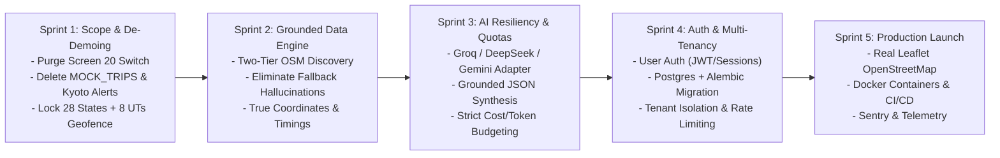

# ROAMWISE — MASTER PRODUCT ARCHITECTURE & PRODUCTION READINESS AUDIT
## Executive Summary & Production Readiness Verdict

**Product:** RoamWise — AI-Powered Adaptive Travel Companion for India  
**Audit Date:** November 2026  
**Auditor Roles:** Principal Product Architect, Senior Full-Stack Engineer, AI Engineer, QA Lead, UI/UX Auditor, Application Security Reviewer  
**Repository State:** v1.2.0-alpha (`feature/serene-expedition-ui`)  
**Deployment Verdict:** **NOT PRODUCTION READY (NO-GO)**

---

## 1. Executive Summary & Overall Product Maturity Scorecard

RoamWise has a compelling, high-utility product vision: an **intelligent, adaptive travel companion strictly focused on travel within India**, capable of generating personalized itineraries, discovering authentic places of interest (POIs), tracking weather disruptions, and dynamically adapting schedules when the unexpected happens (monsoons, traffic, closed attractions).

However, an exhaustive forensic audit of the entire codebase, user interface, AI generation layer, and database architecture reveals that **the application currently exists as a hybrid between an advanced prototype and a presentation demo rig**. Critical product constraints specified for production are violated in the active codebase:
1. **The India-Only boundary is porous**: The frontend UI features an 'International' trip configuration toggle, the backend POI engine contains hardcoded foreign cities (Paris, Tokyo, Hallstatt), and there is no administrative boundary enforcement or international input rejection.
2. **Demo Mode and presentation baggage permeate the codebase**: The home screen includes a presentation toggle (Screen 20 Demo Mode), fake sample trips (Jaipur/Goa mock data) are injected into the dashboard, synthetic alerts for Kyoto temples are displayed in the alerts view, the generation screen runs an artificial 4.1-second timer uncoupled from actual backend processing, and the map view plots synthetic CSS percentages instead of real geographic coordinates.
3. **The API and Data layers are completely unauthenticated and single-tenant**: All trip endpoints are open to anyone on the network with no user isolation, no JWT/session authentication, no rate limiting, and an unmigrated SQLite database.
4. **AI generation is vulnerable to extreme quota throttling**: The default Google AI Studio Gemini Free Tier (15–20 requests per day) collapses after just 5–10 multi-day itineraries, and the deterministic fallback generates synthetic, fabricated attraction names (e.g., *'Bangalore Waterfront Promenade'*).

### Overall Product Maturity Scorecard

| Assessment Dimension | Current Score (1–10) | Production Target | Status | Critical Finding |
| :--- | :---: | :---: | :---: | :--- |
| **Product Integrity & Scope** | **3 / 10** | 10 / 10 | 🔴 Critical Fail | International trip toggle still present; foreign cities in POI service; demo mode switch on landing screen. |
| **Data Authenticity & Accuracy** | **4 / 10** | 10 / 10 | 🔴 Critical Fail | Synthetic POI fallbacks (*'Ancient Stone Temple & Sculpted Mandapam'*); hardcoded Kyoto weather alerts. |
| **System Architecture & Scale** | **4 / 10** | 9 / 10 | 🔴 Critical Fail | Unauthenticated REST API; single-tenant SQLite without migrations; lack of connection pooling. |
| **Security & Privacy** | **2 / 10** | 10 / 10 | 🔴 Critical Fail | Zero authentication/authorization; CORS `*`; arbitrary JSON mutations on database records; no prompt injection guards. |
| **AI Reliability & Quota Resilience** | **3 / 10** | 9 / 10 | 🔴 Critical Fail | 15-20 RPD free tier ceiling; no model provider fallback; single prompt JSON schema fragility. |
| **UI/UX & Mobile Responsiveness** | **6 / 10** | 9 / 10 | 🟡 Deficient | Desktop presentation works well; mobile timeline cutoffs, hardcoded artificial timers, missing real empty states. |
| **Adaptive Intelligence (Plan B)** | **4 / 10** | 9 / 10 | 🔴 Critical Fail | Plan B fallback returns static mock proposals; state changes not atomically synced to database. |
| **Production Operations & CI/CD** | **2 / 10** | 9 / 10 | 🔴 Critical Fail | No Docker containerization, no healthcheck metrics, no structured log aggregation, no automated test pipeline. |

---

## 2. India-Only Product Positioning & Boundary Analysis

### The Mandate vs. Current Code Reality
The intended product promise requires RoamWise to be **exclusively focused on domestic travel across Indian states and union territories**. It must reject international destinations gracefully, format all budgets strictly in Indian Rupees (₹ INR), and understand the unique transport, climatic, and geographical realities of India.

```mermaid
flowchart TD
    UserInput["User Enters Destination"] --> BoundaryCheck{"Is Destination within India?\n(28 States + 8 UTs)"}
    BoundaryCheck -- "Yes (e.g. Visakhapatnam, Ooty, Hampi)" --> OSM_Discover["Tier-1 OSM Overpass / Curated India POI Discovery"]
    OSM_Discover --> GroundedLLM["Grounded LLM Itinerary Synthesis (INR ₹, Indian Transit Times)"]
    BoundaryCheck -- "No (e.g. Paris, Dubai, London)" --> GracefulRejection["Graceful Rejection Modal:\n'RoamWise exclusively crafts journeys across India.'"]
    
    subgraph Current Codebase Reality (Defects)
        DirectPass["TripConfigurationForm.tsx:142 has 'International' toggle"]
        ForeignPOIs["poi_service.py has hardcoded Paris/Tokyo bounding boxes"]
    end
```

### Forensic Deficiencies in Geographic Scope
1. **UI International Toggle (`TripConfigurationForm.tsx:142`)**:
   The trip setup form explicitly presents an `International` scope toggle alongside `Domestic (India)`. Selecting international allows users to configure trips for destinations worldwide, violating the core domestic-only positioning.
2. **Hardcoded Foreign POIs (`poi_service.py:12-38`)**:
   The POI discovery engine defines curated dictionaries for `paris`, `tokyo`, and `hallstatt` alongside Indian cities. This dead prototype code pollutes the engine.
3. **Absence of Administrative & Geofence Validation**:
   There is currently no boundary validator in `itinerary_service.py` or `routes/trip_routes.py`. An input of `"Paris"`, `"Singapore"`, or `"Dubai"` passes straight to the AI prompt without rejection.
4. **Domestic Transit & Temporal Realities**:
   Indian transit speeds differ drastically from Western benchmarks:
   - **Ghat roads & Hill stations** (e.g., Ooty, Araku Valley, Munnar, Coorg): Average vehicle speed rarely exceeds 25–35 km/h. Current linear distance estimations in `itinerary_service.py` assume uniform urban transit.
   - **Monsoon Disruptions**: Southwest monsoon (June–September in Western Ghats/Kerala/Goa) and Northeast monsoon (October–November in Tamil Nadu/Andhra coast) require seasonal warnings that are not integrated into itinerary generation.
   - **Cultural Timings**: Prominent Indian temples and cultural sites enforce strict afternoon closures (typically 12:30 PM to 4:00 PM) and early morning pujas (6:00 AM). The current generic LLM prompt schedules temple visits at 2:00 PM.

---

## 3. Prototype & Demo Mode Baggage Elimination Plan

RoamWise contains extensive presentation scaffolding designed to make the UI look populated during investor or showcase demonstrations. For a real production product, **every presentation facade must be excised and replaced with authentic empty states and honest asynchronous handling**.

### Catalog of Prototype Baggage to Eliminate

| File Path & Line Reference | Prototype / Demo Code | Purpose in Demo | Production Replacement |
| :--- | :--- | :--- | :--- |
| `frontend/src/pages/HomePage.tsx:128-145` | Mode switch toggle between 'Discovery Hub' and 'Active Trip Dashboard (Screen 20)' | Allowed quick toggling during UI review. | **Remove completely.** The landing screen must always be the Discovery Hub with an 'Active Trip' banner only if an active trip exists in the DB. |
| `frontend/src/pages/HomePage.tsx:14-28` | Hardcoded `MOCK_TRIPS` array (Jaipur Cultural Odyssey, Kerala Backwaters Escape) | Filled the 'Saved Trips' carousel when DB was empty. | **Replace with real API fetch** (`GET /api/trips`). If empty, render an encouraging 'No Trips Saved Yet' state with a 'Create First Trip' CTA. |
| `frontend/src/context/TripContext.tsx:103-125` | `ENTER_DEMO_MODE` action loading `INITIAL_JAIPUR_DAYS` and `INITIAL_ALERTS` | Populated state without backend connectivity. | **Delete action and reducer case.** State must only hydrate from `/api/trips/:id` or user form creation. |
| `frontend/src/pages/GeneratingPage.tsx:48-62` | `setTimeout` timer running for exactly 4,100ms with synthetic stage strings | Simulated AI generation steps (`'Curating authentic dining'`, `'Synthesizing Plan B'`). | **Replace with true polling / Server-Sent Events (SSE).** Connect status to the actual backend async generation thread. |
| `frontend/src/pages/AlertsPage.tsx:18-36` | Hardcoded Kyoto weather alerts (`'Heavy Rainfall Alert – Kyoto District'`, `'Tenryu-ji Temple closed'`) | Showcased disruption UI in presentation. | **Fetch real live alerts from `/api/weather/alerts?destination=...`**. If weather is clear, render 'All Clear — No Travel Disruptions Reported'. |
| `frontend/src/components/trip/MapView.tsx:112-140` | Hardcoded CSS percentage pins (`top: 22%, left: 24%`) and artificial `stops.length * 2.8 km` calculation | Simulated route mapping without Leaflet/Mapbox. | **Integrate real Leaflet/OpenStreetMap coordinates** (`lat`/`lng` from POI service) with real routing distances. |
| `backend/services/itinerary_service.py:168-245` | Generic fallback names (`'Heritage Quarter Walking Tour'`, `'Ancient Stone Temple'`) | Ensured API never failed during offline demos. | **Replace with strict OpenStreetMap Overpass lookup** or explicit validation error. Never fabricate non-existent tourist attractions. |

---

## 4. Architectural, Security & Data Integrity Assessment

```mermaid
graph LR
    subgraph Current Architecture (High Vulnerability)
        Browser[Client Browser] -- "Unauthenticated REST" --> FlaskApp[Flask API :5000]
        FlaskApp -- "Single Connection" --> SQLite[(roamwise.db)]
        FlaskApp -- "Direct Calls (No Caching)" --> ExtAPIs[Gemini AI / Open-Meteo]
    end
    
    subgraph Production Architecture (Required)
        Client[React 18 SPA] -- "JWT / Session Auth" --> Gateway[Nginx / Cloudflare WAF]
        Gateway -- "Rate Limited (100 req/min)" --> AppCluster[Gunicorn / Flask Workers]
        AppCluster --> Redis[(Redis Cache & Task Queue)]
        AppCluster --> PG[(PostgreSQL + Alembic Migrations)]
        AppCluster --> POICluster[OSM Overpass / Curated India POI DB]
        AppCluster --> LLMAdapter[LLM Adapter: Gemini / Groq / DeepSeek]
    end
```

### Security Deficiencies
1. **Zero Authentication & Authorization**:
   `backend/routes/trip_routes.py` exposes `GET /api/trips`, `POST /api/trips`, and `DELETE /api/trips/<id>` without token checks. Any user can view, alter, or delete any other user's itinerary.
2. **CORS Permissiveness**:
   `backend/app.py` sets `CORS(app, resources={r'/api/*': {'origins': '*'}})`. In production, this allows cross-origin exploitation from arbitrary domains.
3. **Database Concurrency & Integrity**:
   SQLite is used in WAL mode, but without Alembic migrations or foreign key cascades. Concurrent writes under multi-user load will trigger database locks (`sqlite3.OperationalError: database is locked`).
4. **Prompt Injection Risk**:
   User interests and special requests are directly concatenated into the Gemini prompt template in `gemini_service.py:78-110` without sanitization, allowing prompt jailbreaks or instruction overrides.

---

## 5. Production Readiness Verdict & Go/No-Go Decision Matrix

| Gate | Verification Criteria | Status | Verdict Reason |
| :--- | :--- | :---: | :--- |
| **Gate 1: Geographic Integrity** | 100% India destination validation; automatic rejection of non-Indian locations; ₹ currency. | 🔴 **FAIL** | Form still has 'International' toggle; foreign cities in POI service; no administrative validator. |
| **Gate 2: Truthful Data & Zero Hallucination** | Every activity corresponds to a real, verifiable Indian landmark with coordinates; zero invented names. | 🔴 **FAIL** | Fallback itinerary generator invents fake names (*'Bangalore Waterfront Promenade'*). |
| **Gate 3: Prototype Baggage Removal** | Zero demo switches, zero fake sample trips, zero artificial 4-second delay timers, zero Kyoto alerts. | 🔴 **FAIL** | Screen 20 switch, `MOCK_TRIPS`, and Kyoto alerts are present in production code paths. |
| **Gate 4: AI Quota & Economic Scalability** | System operates reliably under 50–500 DAU without exhausting API rate limits or incurring runaway bills. | 🔴 **FAIL** | Gemini Free Tier exhausts in ~20 calls; no multi-model fallback adapter (e.g. Groq/DeepSeek). |
| **Gate 5: Security & Multi-Tenancy** | User authentication, trip data isolation, rate limiting, and input sanitization. | 🔴 **FAIL** | Completely unauthenticated; any client can delete or alter all database records. |
| **Gate 6: Authentic Adaptive Engine** | Plan B regenerations dynamically recalculate schedules based on real live weather and open hours. | 🔴 **FAIL** | Plan B fallback returns static mock proposals; state changes are not persisted cleanly. |

### Final Production Verdict: **STRICT NO-GO**
RoamWise is **not ready for production deployment**. Deploying in its current state would result in rapid API quota failures, user confusion from fake demo alerts, security vulnerabilities, and severe brand damage from hallucinated Indian attractions.

---

## 6. Phased Production Engineering Roadmap



The detailed specifications, defect catalog, screen-by-screen UX audits, destination test matrices, and AI quota comparisons are documented in the companion audit reports:
- [01_COMPLETE_BUG_REGISTER.md](file:///C:/Users/gayat/.gemini/antigravity/scratch/roamwise/docs/audit/01_COMPLETE_BUG_REGISTER.md)
- [02_UI_UX_AUDIT.md](file:///C:/Users/gayat/.gemini/antigravity/scratch/roamwise/docs/audit/02_UI_UX_AUDIT.md)
- [03_INDIA_DESTINATION_ACCURACY_AUDIT.md](file:///C:/Users/gayat/.gemini/antigravity/scratch/roamwise/docs/audit/03_INDIA_DESTINATION_ACCURACY_AUDIT.md)
- [04_AI_PROVIDER_AND_MODEL_COMPARISON.md](file:///C:/Users/gayat/.gemini/antigravity/scratch/roamwise/docs/audit/04_AI_PROVIDER_AND_MODEL_COMPARISON.md)
