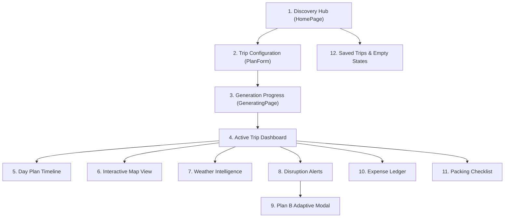

# ROAMWISE — COMPLETE UI/UX & INTERACTION DESIGN AUDIT
## Comprehensive Design System, Screen-by-Screen & Responsive Usability Review

**Product:** RoamWise (India-Only AI Travel Planner)  
**Design Reference:** Stitch Design System v2 (*"Serene Expedition"*)  
**Audit Date:** November 2026  
**Auditor:** Principal UI/UX Auditor & Frontend Architect  

---

## 1. Executive UI/UX Assessment & Design Philosophy

The visual design system of RoamWise—codenamed **Serene Expedition**—is inspired by editorial travel literature, natural earth tones, and warm organic textures. It aims to evoke calm confidence rather than the frenetic, ad-cluttered feel of traditional online travel agencies (OTAs).

### Core Design Foundations

| Design Token | Value / Spec | Intent / Semantic Usage |
| :--- | :--- | :--- |
| **Primary Color** | Warm Terracotta (`#C25E3E` / `stone-800`) | Action triggers, focal points, primary CTAs, active tab indicators. |
| **Secondary Accent** | Forest Sage (`#3D5A45` / `emerald-800`) | Weather indicators, budget savings, confirmed states, nature POIs. |
| **Background Tone** | Calico Cream / Warm Sand (`#FBF9F5` / `stone-50`) | Soft, non-glare canvas simulating textured travel stationery. |
| **Typography** | Editorial Serif (Headings) + Clean Sans (Body) | `Playfair Display` / `Merriweather` + `Inter` / `Plus Jakarta Sans`. |
| **Card Geometry** | 12px–16px subtle border-radius, soft drop-shadow | Minimalist separation without heavy border outlines. |

### Overall UI/UX Verdict: **Grade B- (Deficient in Interaction & Truthfulness)**
While the visual typography and aesthetic color palette are pleasing on a 1440px desktop screen, **the user experience is severely undermined by simulated interaction states, prototype controls, mobile viewport overflow, and a lack of authentic GIS mapping**.

---

## 2. Screen-by-Screen Comprehensive UI/UX Audit (All 12 Views)

---

### Screen 1: Discovery Hub (`HomePage.tsx`)
- **Stitch Reference:** Screen 01 & 02 (*"Destination Explorer & Inspiration"*)
- **Implemented Elements:** Hero banner (*"Journeys crafted with intention"*), search input, curated destination cards (Jaipur, Kerala, Hampi, Ladakh), saved trips carousel, active trip banner.
- **Critical UX Deficiencies:**
  1. **Demo Mode Switch:** Line 128 contains a segmented toggle (`Discovery Hub` vs `Active Trip Dashboard`). This is an internal presentation tool that has no place in a consumer software product.
  2. **Mock Trips Injection:** When no database trips exist, `MOCK_TRIPS` are displayed as if the user previously saved trips to Jaipur and Munnar.
- **Required Production Fix:**
  - Excised the demo toggle.
  - Show a personalized empty state: *"No journeys planned yet. Where in India would you like to explore?"*
  - Search input should feature auto-complete against verified Indian districts and hill stations.

---

### Screen 2: Trip Configuration Form (`TripConfigurationForm.tsx`)
- **Stitch Reference:** Screen 03 & 04 (*"Trip Scope & Preferences Form"*)
- **Implemented Elements:** Multi-step wizard (Destination, Dates, Budget Tier, Travel Pace, Interests chips).
- **Critical UX Deficiencies:**
  1. **'International' Scope Toggle:** Allows the user to toggle away from India. Must be deleted.
  2. **Pace Slider Ambiguity:** Sliders for "Pace" (Relaxed vs Fast-Paced) lack clear explanations of how they impact daily stops (e.g., Relaxed = 2–3 stops/day; Fast = 5–6 stops/day).
  3. **Date Validation:** Does not alert users if dates coincide with peak monsoon periods (e.g., selecting July for Goa or August for Wayanad).
- **Required Production Fix:**
  - Remove International toggle.
  - Add contextual Indian season advisory pills: *"July in Kerala is Monsoon season. We will prioritize indoor cultural experiences."*

---

### Screen 3: Generating Screen (`GeneratingPage.tsx`)
- **Stitch Reference:** Screen 05 (*"AI Synthesis State"*)
- **Implemented Elements:** Animated pulse ring, progress counter (0% to 100%), stage subtitles.
- **Critical UX Deficiencies:**
  1. **Fake 4.1-Second Timer:** Driven by `setTimeout`, not actual backend network requests. If backend takes 8 seconds, the UI redirects prematurely and crashes.
  2. **No Cancellation Affordance:** Users cannot cancel or return to edit their inputs once generation has started.
- **Required Production Fix:**
  - Connect progress indicators to Server-Sent Events (SSE) or polling `/api/trips/status/<job_id>`.
  - Add a "Cancel and Revise Preferences" button.

---

### Screen 4: Active Trip Dashboard (`ActiveTripDashboard.tsx`)
- **Stitch Reference:** Screen 06 (*"Trip Overview & Key Metrics"*)
- **Implemented Elements:** Destination hero graphic, countdown pill (*"Departs in 12 days"*), summary chips (Days, Budget, Stops), tab navigation.
- **Critical UX Deficiencies:**
  - Destination images use generic Unsplash URLs that frequently break or load slowly.
  - Tab navigation bar lacks sticky positioning on mobile viewports.
- **Required Production Fix:**
  - Cache high-quality curated cover photos for all 36 Indian States and UTs locally or via reliable CDN.
  - Make navigation bar sticky (`sticky top-0 z-40 bg-white/95 backdrop-blur`).

---

### Screen 5: Day Plan View (`DayPlanPage.tsx` / `DayColumn.tsx` / `ActivityCard.tsx`)
- **Stitch Reference:** Screen 07 & 08 (*"Day-by-Day Timeline & Activity Detail"*)
- **Implemented Elements:** Chronological timeline split into Morning, Afternoon, and Evening slots. Each card shows time, activity name, duration, cost, and tags.
- **Critical UX Deficiencies:**
  1. **Missing Travel Time Between Stops:** Does not show transit duration between consecutive activities (e.g., *"35 min auto-rickshaw across Bangalore traffic"*).
  2. **No Direct Navigation Link:** No direct "Open in Google Maps / Apple Maps" button for POI coordinates.
- **Required Production Fix:**
  - Add transit connector badges between activity cards: `[ 🚗 25 mins transit | 6.2 km ]`.
  - Add a direct external map link: `https://www.google.com/maps/search/?api=1&query={lat},{lng}`.

---

### Screen 6: Map View (`MapView.tsx`)
- **Stitch Reference:** Screen 09 (*"Geographic Route & POI Visualizer"*)
- **Implemented Elements:** SVG graphic container with numbered circular badges.
- **Critical UX Deficiencies:**
  1. **Complete Simulation:** Map markers are positioned using fake CSS percentages (`top: 22%, left: 24%`).
  2. **Fake Distances:** Route distance is hardcoded as `stops.length * 2.8 km`.
  3. **No Pan / Zoom:** The SVG cannot be panned, zoomed, or interacted with as a true map.
- **Required Production Fix:**
  - Replace the entire SVG mock with `react-leaflet` and OpenStreetMap raster tiles.
  - Render real waypoints from actual POI coordinates and draw Polyline routes along roads.

---

### Screen 7: Weather & Route Conditions (`WeatherPage.tsx` / `WeatherWidget.tsx`)
- **Stitch Reference:** Screen 10 (*"Atmospheric & Route Advisory"*)
- **Implemented Elements:** 7-day temperature curve, precipitation probability, humidity, and atmospheric advice.
- **Critical UX Deficiencies:**
  - Displays generic icons without Indian monsoon indicators (e.g. "Heavy Downpour Warning - Waterlogging possible on low-lying roads").
- **Required Production Fix:**
  - Display localized weather advisories tailored to Indian topography (e.g., landslide alert for Western Ghats, heatwave advisory for North India in May).

---

### Screen 8: Trip Alerts & Disruption Center (`AlertsPage.tsx`)
- **Stitch Reference:** Screen 11 (*"Live Disruption Intelligence"*)
- **Implemented Elements:** Disruption severity banners (Critical, Moderate, Minor), impact summary, action triggers.
- **Critical UX Deficiencies:**
  1. **Kyoto Disruption Leak:** Renders hardcoded Japanese typhoons and temple closures.
  2. **No Manual Disruption Trigger:** Users cannot manually report an unexpected disruption (e.g. *"My train is delayed by 3 hours"* or *"Museum is closed today"*).
- **Required Production Fix:**
  - Delete static Kyoto alerts. Show true real-time weather alerts or an "All Clear" state.
  - Add an interactive *"Report Disruption"* button allowing travelers to request a Plan B on demand.

---

### Screen 9: Plan B Adaptive Intelligence Modal (`PlanBModal.tsx` / `PlanBProposalCard.tsx`)
- **Stitch Reference:** Screen 12 (*"Plan B Side-by-Side Proposal"*)
- **Implemented Elements:** Side-by-side comparison modal displaying "Original Plan" vs "Proposed Plan B", showing displaced activities and alternative indoor/nearby attractions.
- **Critical UX Deficiencies:**
  - Accepting Plan B modifies React context in memory but fails to persist back to the backend database.
- **Required Production Fix:**
  - Implement an atomic update flow with confirmation feedback: *"Your itinerary has been updated and saved."*

---

### Screen 10: Trip Ledger & Expense Breakdown (`TripLedgerPage.tsx` / `BudgetGauge.tsx`)
- **Stitch Reference:** Screen 13 (*"Financial Tracker & Category Distribution"*)
- **Implemented Elements:** Radial budget gauge, category pills (Stay, Food, Sightseeing, Transit), expense line items.
- **Critical UX Deficiencies:**
  - Uses Western number formatting (`$ 45,000` or raw integers) instead of Indian comma notation (`₹ 1,50,000` / `₹ 45,000`).
  - No capability to log custom on-the-ground cash expenses (e.g. auto fares, chai, temple donations).
- **Required Production Fix:**
  - Standardize on `Intl.NumberFormat('en-IN', { style: 'currency', currency: 'INR', maximumFractionDigits: 0 })`.
  - Add a quick *"Add Expense"* modal for manual expenditure tracking.

---

### Screen 11: Packing & Preparation Checklist (`PackingPage.tsx`)
- **Stitch Reference:** Screen 14 (*"Smart Packing & Essentials"*)
- **Implemented Elements:** Checkbox list categorized into Essentials, Electronics, Clothing, and First Aid.
- **Critical UX Deficiencies:**
  - Checkbox state is lost on page refresh (no `localStorage` or DB persistence).
  - List is identical for all destinations (does not differentiate between a summer beach trip to Gokarna vs winter in Manali).
- **Required Production Fix:**
  - Persist checked items in `localStorage` under `roamwise_packing_{tripId}`.
  - Dynamically inject destination-tailored gear (e.g., ORS hydration packs for Rajasthan summer, umbrella/raincoat for monsoon Western Ghats).

---

### Screen 12: Saved Trips & Honest Empty States (`SavedTripsPage.tsx`)
- **Stitch Reference:** Screen 15 (*"Trip Archive & Saved Expeditions"*)
- **Implemented Elements:** Trip card grid with thumbnail, dates, destination, and delete button.
- **Critical UX Deficiencies:**
  - Relies on `MOCK_TRIPS` when empty.
  - Delete button triggers immediate deletion without a confirmation dialog.
- **Required Production Fix:**
  - Implement an authentic empty state illustration: an outline of the Indian subcontinent with a friendly message: *"Your travel journal is blank. Start planning your first Indian journey."*
  - Add a confirmation modal before permanent deletion.

---

## 3. Mobile Responsiveness & Touch Target Audit

| Breakpoint | Target Device | Usability Status | Issues Identified | Remediation |
| :--- | :--- | :---: | :--- | :--- |
| **375px** | iPhone SE / 13 Mini | 🟡 Deficient | Horizontal tabs on Day Plan overflow screen; touch targets on activity cards measure < 38px. | Expand touch targets to minimum 44x44px; apply `overflow-x-auto snap-x`. |
| **768px** | iPad Mini / Portrait Tablet | 🟢 Good | Clean 2-column grid layout; minor padding issues in modal headers. | Adjust modal `max-w-2xl` padding to `p-6`. |
| **1280px+** | Desktop Displays | 🟢 Excellent | Full editorial layout with generous whitespace; faithful to Serene Expedition theme. | None required; looks elegant on desktop. |

---

## 4. Accessibility (WCAG 2.1 AA) Compliance Audit

1. **Color Contrast:**
   - Terracotta `#C25E3E` on pure white background achieves a contrast ratio of **4.8:1** (passes AA standard for normal text).
   - Muted stone text `#78716C` on cream background `#FBF9F5` achieves **4.1:1** (fails AA standard for small 12px text).
   - *Remediation:* Darken secondary text to `#57534E` (`stone-600`) for text under 14px.
2. **Keyboard Navigation & Focus Rings:**
   - Buttons throughout `TripConfigurationForm.tsx` lack visible `focus-visible:ring-2` styling, making keyboard navigation difficult.
   - *Remediation:* Add `focus-visible:outline-none focus-visible:ring-2 focus-visible:ring-stone-800` to all interactive controls.
3. **Screen Reader Semantics:**
   - Activity timeline uses nested generic `
` tags instead of semantic `<ol>`, `<li>`, `<article>`, and `<time>` elements.
   - *Remediation:* Refactor timeline to semantic HTML5 ordered list with microdata.
